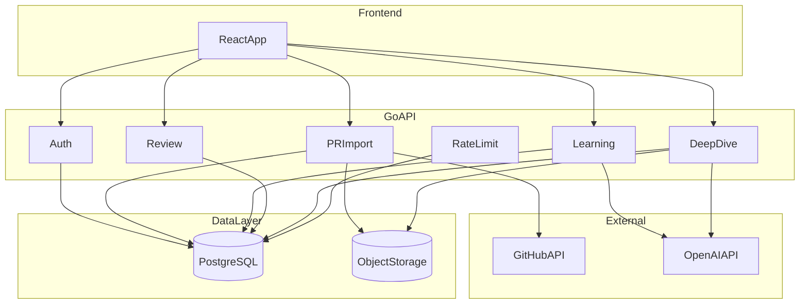
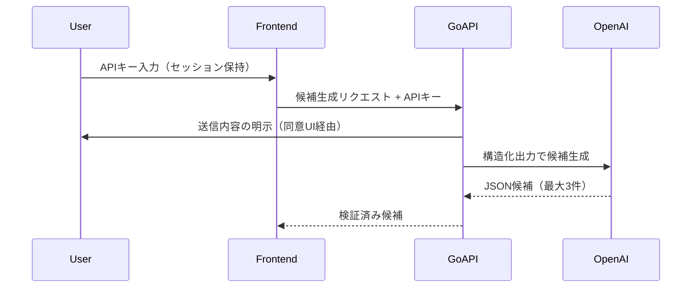

# Code Learning Companion MVP 実装計画

> **旧計画・履歴資料。新規実装の指示には使わない。** 現行は[第二案](implementation-plan-v2.md)。
> フェーズ2の未決課題は現行方針と照合して引き継ぐ。旧BYOK・画面・リリース条件は適用しない。

MVP を仕様書順（01→06）かつ Docker Compose 開発環境で段階的に実装する計画。公開ベータ完成条件10項目をリリース基準とする。

## 進捗チェックリスト

- [x] フェーズ0: Docker Compose + Go/React 骨格 + DB マイグレーション基盤
- [x] フェーズ1 (spec 01): GitHub OAuth、users テーブル、セッション、認可ミドルウェア
- [x] フェーズ2 (spec 02): 公開 PR 取り込み、スナップショット保存、周辺コード取得
- [ ] フェーズ3 (spec 03): OpenAI BYOK、候補・問題・回答・フィードバック、根拠検証
- [ ] フェーズ4 (spec 04): 復習スケジュール、別角度再出題、日時進めテスト支援
- [ ] フェーズ5 (spec 05): 深掘り対話、会話ログ、LearningNote 保存
- [ ] フェーズ6 (spec 06): PR/アカウント削除、利用上限、公開ベータ情報明示
- [ ] 公開ベータ完成条件10項目の E2E テスト + README 整備

## 現状

- フェーズ 0 から 2 まで main にマージ済み（PR #2 から #18）
- 起動は Docker Compose。PostgreSQL、MinIO、Go API、React
- ログイン済みユーザーが公開 PR を取り込み、head SHA 固定のスナップショットと任意の会話 Markdown を保存できる
- 会話ファイルのテーブル名は `conversation_uploads`
- 次はフェーズ 3（[specs/03-learning-questions.md](specs/03-learning-questions.md)）
- 技術スタックは要件定義で確定: **React + TypeScript / Go / PostgreSQL / Object Storage / GitHub OAuth / OpenAI BYOK**

## 方針

| 項目 | 決定 |
|---|---|
| 着手順 | 仕様書順（01 → 06）で基盤から積み上げ |
| 開発環境 | Docker Compose（PostgreSQL + MinIO + API + Frontend） |
| PR 単位 | [detailed-design.md](detailed-design.md) のルール通り、**仕様書1つ = 実装PR1つ** |
| スコープ | [future-ideas.md](../future-ideas.md) は MVP 完了まで触らない |

## リポジトリ構成（提案）

```text
/
├── docker-compose.yml
├── .env.example
├── backend/          # Go API
│   ├── cmd/server/
│   ├── internal/
│   │   ├── auth/
│   │   ├── github/
│   │   ├── openai/
│   │   ├── primport/
│   │   ├── learning/
│   │   ├── review/
│   │   ├── deepdive/
│   │   ├── storage/   # S3互換（MinIO）
│   │   └── db/
│   └── migrations/
├── frontend/         # React + TypeScript (Vite)
│   └── src/
│       ├── pages/
│       ├── components/
│       └── api/
└── docs/             # 既存
```

## アーキテクチャ概要



## フェーズ 0: 開発基盤（実装 PR 前の土台）

**目的:** `docker compose up` で全サービスが起動し、以降の仕様 PR を載せられる状態にする。

**作業内容:**

- `docker-compose.yml`: PostgreSQL、MinIO（S3互換）、Go API、Frontend（Vite dev server）
- `.env.example`: `GITHUB_CLIENT_ID/SECRET`、`DATABASE_URL`、`S3_ENDPOINT`、`OPENAI_MODEL` など
- Go: ルーティング骨格、設定読み込み、DB接続、マイグレーション基盤（[golang-migrate](https://github.com/golang-migrate/migrate) 等）
- Frontend: Vite + React + TypeScript、API クライアント骨格、基本レイアウト
- ヘルスチェック API（`/health`）と DB 接続確認

**完了条件:** Compose 起動 → フロント表示 → API ヘルス OK

---

## フェーズ 1: [01-authentication.md](specs/01-authentication.md)

**目的:** GitHub OAuth でユーザー識別、データの `user_id` 分離。

**バックエンド:**

- `users` テーブル（`github_user_id`, `github_login`, `display_name`, `avatar_url`）
- OAuth フロー: `/auth/github/login` → callback → セッション Cookie 発行
- 認証ミドルウェア: 未ログインは学習 API を 401
- ログアウト: セッション無効化

**後で行うリファクタリング:**

- [ ] 手順 5（ログイン開始・コールバック）の実装後、`backend/internal/auth/github.go` の `FetchGitHubUser` 内部を分割する。公開関数の引数・戻り値は維持し、非公開関数 `exchangeGitHubCode` に認可コードとアクセストークンの交換、`fetchGitHubProfile` にプロフィール取得を担当させる。`FetchGitHubUser` はこの 2 つを順に呼び出す。3 関数は同じファイルに置き、アクセストークンをコールバック側へ返さず、認可コード・トークンをログや DB に残さない方針を維持する。分割後は各 API のリクエストと成功・失敗時の処理を個別にテストする。

- [ ] GitHub 通信の分割後、`GitHubCallback` からログイン処理を `auth.Service` へ分離する。Service はプロフィール取得、ユーザー保存、セッショントークン生成、有効期限の決定、セッション保存を担当する。Handler はクエリ・Cookie の読み取り、state 検証、HTTP エラー応答、Cookie 発行、リダイレクトを担当する。`sql.NullString` への変換も Handler の外へ移し、Service は `http.ResponseWriter` や `*http.Request` に依存させない。HTTP を介さずログイン処理の成功・失敗をテストできるようにする。
- [ ] `oauth_state` Cookie の発行・削除と `session` Cookie の発行を、Handler 側の補助関数に整理する。Path・HttpOnly・SameSite・Secure などの設定をそろえ、state Cookie を成功・失敗どちらでも削除すること、DB と session Cookie の有効期限が一致することを維持する。
- [ ] 優先度低: `main.go` 内のヘルスチェックハンドラと CORS 処理を分離し、`main` は設定読み込み・依存関係の組み立て・ルート登録・サーバー起動を中心にする。

現時点では `Store` は認証関連の DB 操作として維持し、ユーザー用・セッション用への構造体分割は行わない。ファイルの移動だけでなく、処理が依存する情報と判断の責任を整理する。

**フロントエンド:**

- ログイン / ログアウト UI
- 認証状態に応じたルートガード

**受け入れ条件（仕様書より）:**

- 同一 GitHub ID → 同一アプリユーザー
- ユーザー A はユーザー B のデータにアクセス不可
- 非公開リポジトリ権限を要求しない

---

## フェーズ 2: [02-public-pr-import.md](specs/02-public-pr-import.md)

**目的:** 公開 PR URL からスナップショットを取得・保存。

**データモデル（PostgreSQL + Object Storage）:**

| エンティティ | PostgreSQL | Object Storage |
|---|---|---|
| PRSnapshot | メタデータ、head SHA、状態 | 本文、差分、レビューコメント |
| ConversationUpload | ファイル名、関連 PR | Markdown 本文 |

**バックエンド:**

- PR URL 検証（公開のみ、形式チェック）
- GitHub REST API: PR 詳細、diff、files、commits、review comments
- 周辺コード取得（差分不足時のみ、仕様の3段階）
- エラー種別: 形式不正 / 非公開・不存在 / API 一時エラー
- 任意: 会話 Markdown のアップロード（multipart）

**フロントエンド:**

- PR URL 入力フォーム
- 会話ファイルの任意アップロード
- 取り込み進捗・エラー表示

**受け入れ条件:**

- 公開 PR を URL で取り込める
- 取り込み後 GitHub 上の PR が変わってもスナップショットは不変
- 会話ファイルなしでも取り込める

### 未決課題（2026-10-14 レビュー）

以下は公開 PR 取り込みの詳細手順案をレビューして挙がった課題。現時点では判断を保留し、設定・テーブル・URL 解析など、判断に依存しない作業は進めてよい。各項目は関連する処理の実装時に見直し、フェーズ2の完了判断までに対応または制約を明記する。記載した対応案は未決定であり、既存仕様を変更するものではない。

- [ ] **取得中の PR 更新と整合性:** 詳細取得後に PR が更新されると、head SHA と diff・files が食い違う可能性がある。取得前後の head/base SHA 確認と再試行を検討する。本文・コメントも含めた厳密な同一瞬間のコピーは保証できないため、スナップショットの保証範囲を定義する。
- [ ] **保存失敗時の後始末:** DB 保存失敗だけでなく、MinIO の Put 途中失敗でも保存済みオブジェクトを削除する。削除失敗時の検知・再削除、DB・MinIO 障害時の API エラーを決める。両ストレージに必ず何も残らないとは保証しない。
- [ ] **変更ファイル本文の取得・除外:** サイズや NUL の有無を本文取得前に判定できるとは限らない。削除済み・依存ディレクトリの事前除外と、読み取り量を制限した本文判定を整理する。patch も存在しない場合を含め、未保存の理由を記録する。
- [ ] **GitHub クライアントのファイル分割:** 取得処理の実装後、同じ `internal/github` パッケージ・同じ `Client` のまま、関連するメソッドを役割ごとにファイルへまとめる。分割案は `client.go`（Client 定義・生成・共通リクエスト作成）、`fetch.go`（FetchPR）、`pull.go`（PR 詳細・diff）、`files.go`（変更ファイル一覧）、`commits.go`（コミット一覧）、`comments.go`（レビューコメント一覧）、`content.go`（本文取得・除外・サイズ判定）。`types.go`・`errors.go`・`pagination.go`・`convert.go` は現在の役割を維持する。1メソッド1ファイルにはせず、呼び出し方・動作を変えない整理とし、各ファイルの import を調整してビルド・既存テストで確認する。Client や Service の分離はこの課題に含めない。
- [ ] **本文取得の除外ルールの拡張（後続機能）:** 初期実装は `node_modules`・`vendor` の固定ルールで進める方針で合意済み。対象ファイルは本文の追加取得を省略し、ファイル情報と取得できた patch を残す。将来は標準の除外ルールを設定として管理し、ユーザーがリポジトリごとに取得対象を選択したり、除外ルールを追加・解除したりできる形を検討する。自動収集では、開始時点で存在しないディレクトリにも適用できるパスのルールを持ち、新規ファイルの検知時にも照合する。収集中の設定変更と取得済みデータの扱いは別途決める。サーバー側でも対象リポジトリ・変更ファイルとの照合と、ファイルサイズ・全体容量・件数・時間の上限を適用し、除外リストの網羅性だけに依存しない。省略理由を保存・表示する。これらの拡張は MVP 後に検討する。
- [ ] **周辺コードの取得範囲:** 既存仕様の「差分だけでは不足する場合のみ取得」と、手順案の「対象の変更ファイル本文を先に保存」のどちらにするか決める。変更する場合は spec 02 も更新する。ファイル単位だけでなく、取り込み全体の容量・時間上限も決める。
- [ ] **一覧取得の完全性と上限:** ページ送り終了だけで完全取得とみなさず、PR 詳細の件数との照合を検討する。PR コミット API の最大250件などの制約と、取り込み上限超過を一時障害と区別するエラーを整理する。参照: [GitHub REST API](https://docs.github.com/en/rest/pulls/pulls#list-commits-on-a-pull-request)。
- [ ] **GitHub API の利用制限と本番運用（2026-10-22 追記）:** 開発中、API コンテナの `GITHUB_TOKEN` が未設定の状態で、以前取得できた公開 PR の取得が失敗した。GitHub の応答は `403`、`X-RateLimit-Limit: 60`、`X-RateLimit-Remaining: 0`、メッセージは `API rate limit exceeded` だった。現在はこれを `github_unavailable` にまとめ、クライアントへ `502` を返している。アプリへの OAuth ログインと、バックエンドの PR 取得用認証は別。1回の取り込みで詳細・差分・一覧・各ファイル本文など複数の API 呼び出しが発生するため、本番運用前に取得用認証の方式・権限・トークン管理、複数ユーザーで共有する利用枠、取り込み回数・同時実行数の制御を検討する。残り回数・リセット時刻等の扱い、利用制限と一時障害の区別、再試行の制御と画面での案内も決める。認証を付けても上限はある前提とする。ユーザーの意向により今回は課題の記録のみとし、方式の決定・実装は後で検討する。
- [ ] **大規模 PR の対応と上限超過の案内:** 初期実装は小規模な PR を対象とし、各一覧 API は `per_page=100`・最大10ページとする方針で合意済み。10ページ目にも `next` がある場合は `github_unavailable` を返し、部分的な取得結果は保存しない。今後、上限超過を一時障害と区別する専用エラー（例: `pr_too_large`）と、「取り込み上限を超えているため、変更規模の小さい PR を選んでください」などの画面表示を検討する。同じ PR の再試行だけでは解決しないことを伝える。大規模 PR への対応・上限の見直しは、取得時間・API 呼び出し回数・メモリ使用量を踏まえて別途検討する。
- [ ] **Markdown の検証と再添付:** `ParseMultipartForm` の引数はアップロード上限ではないため、別途読み取り制限と一時ファイル削除を設ける。空ファイルの扱いを統一する。保存済み PR にファイルだけ再添付する API を追加するか、再取り込みで新しいスナップショットが増える仕様にするか決める。参照: [Go net/http](https://pkg.go.dev/net/http#Request.ParseMultipartForm)。
- [ ] **一覧が0件の場合の表示:** コミット・変更ファイル・レビューコメントの一覧について、全ページの取得が正常に完了し、完全性の確認を満たした結果が0件の場合に「コミットはありません」「レビューコメントはありません」などの案内を表示する。1ページだけの結果で0件と判断せず、取得中・取得失敗・上限超過を正常な0件と区別する。取得失敗時はエラーを案内し、空の一覧として表示しない。画面実装時に対応する。
- [ ] **公開状態の検証:** サーバ用 PAT の権限設定だけに依存せず、取得対象が公開リポジトリであることを明示的に検証する。
- [x] **MinIO の起動待ち:** 現在の開発環境で `mc` の存在と `mc ready local` の成功を確認した。API の依存条件には `service_healthy` を採用し、既存のヘルスチェック成功後に起動する。Compose で API を再作成し、MinIO が Healthy になってから API が起動することも確認済み。
- [ ] **オブジェクトキーのパス検証:** `..` の文字列置換は正当な名前を変えたり衝突を起こしたりするため、パス要素としての不正値を拒否する方針を検討する。

---

## フェーズ 3: [03-learning-questions.md](specs/03-learning-questions.md)

**目的:** プロダクトの核心 — 学習候補・問題・回答・フィードバック。

**データモデル:**

```text
LearningCandidate → LearningSet → Question → AnswerAttempt
```

各エンティティに **根拠参照**（PR番号、commit SHA、ファイルパス、行範囲）を必須化。

**OpenAI BYOK フロー:**



**重要実装ポイント:**

- API キーは **リクエストヘッダーで受け取り、保存・ログ出力しない**（[requirements.md](../requirements.md) §10）
- OpenAI Structured Outputs で候補・問題・フィードバック JSON を生成し、**根拠参照なしは保存拒否**
- 設計意図問題は根拠（PR本文、レビュー、取り込んだ会話）がある場合のみ
- 問題セット: 選択肢 → 自由記述 → コード記述（2〜3問）
- 理解度: `できた` / `一部できた` / `もう一度` / `判定保留`
- エラー区別: キー無効 / 上限・残高 / 通信 / 出力形式不正

**フロントエンド:**

- API キー入力モーダル（初回 LLM 利用時）
- 送信同意ダイアログ（PR と会話の内容の明示）
- 候補一覧（最大3件）→ 1件選択
- 問題解答 UI、根拠表示（`この問題の根拠を見る`）、フィードバック

**受け入れ条件:** 公開ベータ条件 4〜6 に相当

---

## フェーズ 4: [04-review.md](specs/04-review.md)

**目的:** 間隔反復復習（3日 → 14日 → 30日 → 定着済み）。

**データモデル:**

- `ReviewSchedule`: LearningSet、段階、次回日時、状態、最終理解度

**ロジック:**

- 初回学習完了 → 3日後の ReviewSchedule 作成
- 理解度に応じた遷移（`一部できた` は短間隔、`もう一度` は翌日）
- 復習問題は同一 PR スナップショット、**別問い方**で OpenAI 生成
- `復習を終了` / `復習を再開` / `元に戻す`

**テスト支援:**

- 開発・テスト用に **日時を進める API または環境変数**（仕様: 実時間待ちは公開条件にしない）

**フロントエンド:**

- ホーム: 今日の復習予定（最大3件）
- 復習フロー UI

**受け入れ条件:** 公開ベータ条件 7 に相当

---

## フェーズ 5: [05-deep-dive.md](specs/05-deep-dive.md)

**目的:** 問題文脈を保った LLM 自由対話。

**データモデル:**

- `DeepDiveSession`, `DeepDiveMessage`（本文は Object Storage 可）
- `LearningNote`: ユーザー保存の要点・未解決点

**制約（仕様厳守）:**

- 深掘りは **問題・理解度・復習予定を変更しない**
- 問題再生成はしない
- 通常の問題生成コンテキストには **保存した要点のみ** 使用

**フロントエンド:**

- 問題画面からいつでも「深掘りする」
- チャット UI + 要点保存

**受け入れ条件:** 公開ベータ条件 8 に相当

---

## フェーズ 6: [06-data-lifecycle.md](specs/06-data-lifecycle.md)

**目的:** 削除・利用上限・公開ベータ要件の完成。

**PR 単位削除:**

- カスケード削除: スナップショット、候補、問題、回答、復習、深掘り、会話ファイル
- Object Storage 上の本文も削除
- 最終確認ダイアログ（復元不可）

**アカウント削除:**

- ユーザー全データ + Object Storage + セッション完全削除

**利用上限（設定値化）:**

- PR 解析: 1ユーザー / 日 5件
- LLM 呼び出し: 1ユーザー / 分 10回
- 超過時は実行せず理由表示

**公開情報:**

- README / アプリ内に: 公開 PR のみ、OpenAI 送信範囲、API キー非保存、削除方法を明示

**受け入れ条件:** 公開ベータ条件 9〜10 に相当

---

## データベース初期スキーマ（フェーズ横断で設計、段階的マイグレーション）

フェーズ 1 から順にマイグレーションを追加。全体像:

```text
users
sessions
pr_snapshots
conversation_uploads
learning_candidates
learning_sets
questions
answer_attempts
review_schedules
deep_dive_sessions
deep_dive_messages
learning_notes
usage_limits / rate_limit_counters（または Redis 相当の PG テーブル）
```

すべての学習データに `user_id` FK。Object Storage キーは `{user_id}/{resource_type}/{id}` 形式。

---

## テスト戦略

| 層 | 方針 |
|---|---|
| Go 単体 | GitHub URL パース、根拠参照検証、復習スケジュール遷移、レート制限 |
| Go 統合 | OAuth モック、GitHub API モック、OpenAI モック（構造化出力 fixture） |
| Frontend | 主要フローのコンポーネントテスト（候補選択、問題回答、削除確認） |
| E2E | 公開ベータ完成条件 10 項目を Playwright 等でシナリオ化（日時進め API 利用） |

OpenAI 実 API は CI では使わず、**fixture JSON** で構造化出力を検証する。

---

## 公開ベータ完成チェックリスト

[requirements.md](../requirements.md) §12 の 10 項目を最終ゲートとする:

1. GitHub OAuth ログイン
2. 公開 PR URL 入力
3. OpenAI API キー（セッション）入力
4. PR 解析 → 最大3候補表示
5. 1候補の問題セット回答
6. 回答・苦手理由・フィードバック保存
7. 復習予定 + 別角度の再出題
8. 深掘り対話
9. PR 単位 / アカウント削除
10. 利用上限・エラー表示

---

## リスクと対策

| リスク | 対策 |
|---|---|
| LLM 問題品質・判定のばらつき | 構造化出力スキーマ + 根拠必須バリデーション；プロンプトを backend に集約し fixture テスト |
| GitHub API レート制限 | 未認証 or PAT 利用方針を早期決定；解析上限（5件/日）と整合 |
| BYOK の利用ハードル | MVP では許容；README にキー取得手順を記載 |
| 周辺コード取得の複雑さ | フェーズ2では最小実装（前後行 + 同一ファイル定義）から開始 |
| 復習日時の E2E | テスト用日時オフセット API をフェーズ4で必須実装 |

---

## 実装 PR 順序（推奨）

1. **chore:** Docker Compose + プロジェクト骨格（フェーズ 0）
2. **feat:** GitHub OAuth + ユーザー分離（フェーズ 1 / spec 01）
3. **feat:** 公開 PR 取り込み（フェーズ 2 / spec 02）
4. **feat:** 学習候補・問題・回答（フェーズ 3 / spec 03）— 最大工数
5. **feat:** 復習スケジュール（フェーズ 4 / spec 04）
6. **feat:** 深掘り対話（フェーズ 5 / spec 05）
7. **feat:** 削除・利用上限・公開情報（フェーズ 6 / spec 06）
8. **test/docs:** E2E + 公開ベータ README 整備

各 PR 完了時に、対応仕様書の「受け入れ条件」を自分の言葉で説明できることを [detailed-design.md](detailed-design.md) の開発確認方法に従って確認する。
