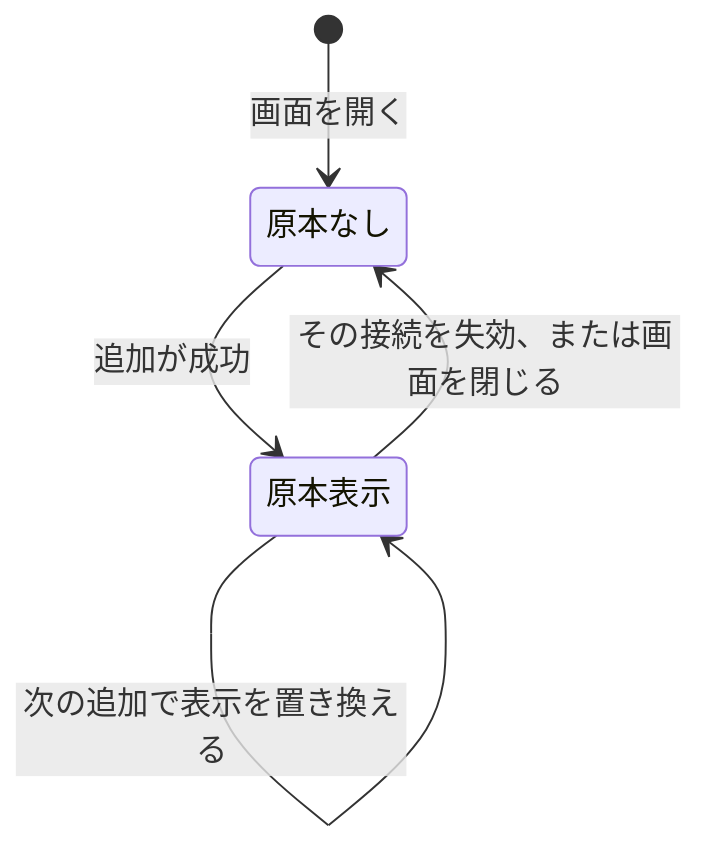

# 接続画面の学習ノート

仕様は [07 の接続画面と名前変更API](../specs/07-agent-connection.md)。再接続の欄は [再接続の画面](reconnect-screen.md)。用語は [用語集](glossary.md) の接続名と原本。

画面は、ログインした本人が、AIツールへ渡す接続を足し、見分け、失効する。学習中には使わない。

## 1. この機能は何のためか

使う人は、Webにログインした本人。接続名は、codex や cursor のような表示ラベル。認証には使わない。
トークンの原本は、追加した直後だけ、この節の表示に出す。一覧から取り直せない。再接続で発行した原本は [再接続の画面](reconnect-screen.md)。
使えない接続は、同じ名前を追加欄へ戻すところまで。新しいトークンは「追加する」まで作らない。

## 2. 状態の流れ

トークンの期限と失効は、サーバーの行が持つ。画面の「有効」「使えない」は、その行を見てその場で決める。保存する画面状態は無い。

| きっかけ | 画面 | サーバー |
|---|---|---|
| 一覧を読む | 名前と状態と操作を出す | 読まない。`GET /connection-tokens` |
| `revoked_at` が空で、`expires_at` が今より後 | 「有効」。名前を変える、再接続、失効 | 再接続は [再接続の画面](reconnect-screen.md) |
| `revoked_at` がある、または `expires_at` が今ちょうど以降 | 「使えない」。作り直す | 変えない |
| 追加する | 成功したら原本を1件出す。入力は「AIエージェント」に戻す | 発行する |
| 作り直す | 追加欄をその名前にして入力へ移す | 変えない |
| 名前を変える、保存する | 有効な行だけ。成功で一覧を読み直す | 表示名だけ更新する |
| 失効を確認する | その原本を出しているなら消す | 失効する |
| 確認を取り消す | そのまま | 変えない |

未完了の置き換え先は、一覧APIが返さない。24時間以内も含む。画面はその行を受け取らない。説明は [接続一覧](token-list.md)。

## 3. 呼び出しの流れ

画面は [App.tsx](../../frontend/src/App.tsx) のログイン後、取り込み履歴の下。中身は [ConnectionSection.tsx](../../frontend/src/connection/ConnectionSection.tsx)。別ルートは無い。

### 追加

| 順 | 呼び出し | SQL |
|---|---|---|
| 1 | [ConnectionSection.tsx ConnectionSection](../../frontend/src/connection/ConnectionSection.tsx) の `handleCreate` | なし |
| 2 | [connectionTokens.ts createConnectionToken](../../frontend/src/api/connectionTokens.ts) | なし。`POST /connection-tokens`。Cookie 付き |
| 3 | [handler.go Handler.Issue](../../backend/internal/connectiontoken/handler.go) | なし |
| 4 | [service.go Service.Issue](../../backend/internal/connectiontoken/service.go) | `connection_tokens` へ INSERT。原本は返すが保存しない |

### 一覧と状態

| 順 | 呼び出し | SQL |
|---|---|---|
| 1 | `ConnectionSection` の初回 effect と `reload` | なし |
| 2 | [connectionTokens.ts listConnectionTokens](../../frontend/src/api/connectionTokens.ts) | なし。`GET /connection-tokens` |
| 3 | [handler.go Handler.List](../../backend/internal/connectiontoken/handler.go) | なし |
| 4 | [manage.go Service.List](../../backend/internal/connectiontoken/manage.go) | 本人の行を新しい順で SELECT。`completed` でない置き換え先は除く。詳細は [接続一覧](token-list.md) |
| 5 | [status.ts connectionStatus](../../frontend/src/connection/status.ts) | なし。`revoked_at` と `expires_at` で「有効」か「使えない」 |

### 名前変更

| 順 | 呼び出し | SQL |
|---|---|---|
| 1 | `ConnectionSection` の `saveRename` | なし。有効な行の「保存する」から |
| 2 | [connectionTokens.ts renameConnectionToken](../../frontend/src/api/connectionTokens.ts) | なし。`POST /connection-tokens/{id}/rename` |
| 3 | [handler.go Handler.Rename](../../backend/internal/connectiontoken/handler.go) | なし。未ログインは401。UUIDでなければ400。本文は発行と同じ |
| 4 | [manage.go Service.Rename](../../backend/internal/connectiontoken/manage.go) | `name` だけ UPDATE。0件は `ErrTokenNotFound` |

### 失効と作り直す

失効は `ConnectionSection` の `handleRevoke` から [connectionTokens.ts revokeConnectionToken](../../frontend/src/api/connectionTokens.ts)、[handler.go Handler.Revoke](../../backend/internal/connectiontoken/handler.go)、[manage.go Service.Revoke](../../backend/internal/connectiontoken/manage.go)。確認を取り消すと、ここへ進まない。

作り直すは `ConnectionSection` のボタンだけ。追加欄の `name` をその行の名前にし、入力へ移す。APIもSQLも呼ばない。

## 4. 関数ごとの表

| 関数 | 目的 | 入力 | 出力 | 更新するもの |
|---|---|---|---|---|
| `connectionStatus` | 行の表示 | `revoked_at`、`expires_at`、今 | 「有効」か「使えない」 | なし |
| `createConnectionToken` | 発行を呼ぶ | 接続名 | `token` と `secret` | なし。失敗はエラーコード |
| `listConnectionTokens` | 本人の一覧 | なし | メタデータの配列 | なし |
| `renameConnectionToken` | 表示名を変える | ID、接続名 | メタデータ。原本は捨てる | なし |
| `revokeConnectionToken` | 失効する | ID | なし | なし |
| `Service.Rename` | 所有者の表示名だけ変える | ユーザーID、トークンID、名前 | `Token` | `connection_tokens.name` |
| `Handler.Rename` | Web入口 | Cookie、パスのID、JSONの `name` | 200 `{"token":メタデータ}` | サービス経由で名前 |

`Service.Rename` は、前後の空白を除いて空なら `ErrInvalidName` を返し、SQLを実行しない。他人と存在しないIDはどちらも `ErrTokenNotFound`。ハッシュ、原本、作成日時、期限、失効日時は変えない。

## 5. なぜそうしたか

原本はブラウザのメモリだけに置く。localStorage には書かない。次の追加で、前の表示を置き換える。前のトークンは失効しない。
名前変更を POST にしたのは、既存のCORSが GET・POST・OPTIONS だけだから。PATCHにすると許可を広げる必要があった。
行の「有効」「使えない」は、一覧の `expires_at` と `revoked_at` だけで決める。再接続の欄は、再接続APIの状態を別に見る。未完了の置き換え先は、一覧APIが先に除く。
作り直すで発行しないのは、使えない行を見ただけで新しい原本を出したくないため。

## 6. 未決

- 再接続の欄は [再接続の画面](reconnect-screen.md)。未完了の置き換え先を一覧から外すことは決定済みで、説明は [接続一覧](token-list.md)。
- 設定文の雛形。この画面には出さない。
- 接続名の文字数、発行件数、頻度の上限。
- ブラウザの時計とサーバーの時計のずれ。画面は補正しない。
