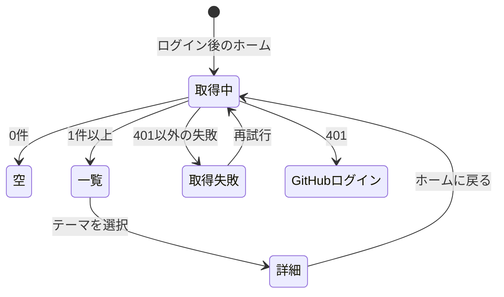

# 復習期限一覧の画面

API契約は [仕様04](../specs/04-review.md#期限到来一覧) を参照する。

## 何のためか

ログインした本人が、ホームで復習期限を迎えた記録を探して詳細を開く。たとえば一覧に「Go のエラー処理」があれば、復習の回数と期限を確認し、テーマを押して保存済みの問題・回答・解説を見返せる。

## 状態の流れ

## 呼び出しの流れ

1. `App.tsx:App` → `learning/DueReviewsSection.tsx:DueReviewsSection`。ログイン後のホームで学習履歴の上に表示する。
2. `learning/DueReviewsSection.tsx:loadDueReviews` → `api/learningRecords.ts:listDueReviews`。Cookie付きで `GET /web/reviews/due` を呼ぶ。
3. `auth/middleware.go:RequireAPIAuth` → `learningrecord/handler_web.go:listDueReviews` → `learningrecord/review.go:Service.listDueReviews`。SQLで本人の記録の次の未保存段階と期限を計算する。詳細は [復習期限一覧](web-due-reviews.md) を参照する。
4. `learning/DueReviewsSection.tsx:loadDueReviews` が結果を反映する。401では `App.tsx:handleSessionExpired` へ進む。テーマのクリックでは `App.tsx:handleNavigate` がパスを更新し、[学習記録の詳細画面](learning-record-detail.md) を表示する。

## 関数ごとの表

| 関数 | 目的 | 入力 | 出力 | 更新するもの |
|---|---|---|---|---|
| `listDueReviews` | Webセッションで期限一覧を読む | 中断シグナル | 記録の配列、401なら `null`、その他の失敗ならエラー | なし |
| `loadDueReviews` | 取得結果を画面に渡す | 中断シグナル | なし | 一覧の表示状態、401時のログイン状態 |
| `DueReviewsSection` | 期限一覧と取得状態を表示する | 遷移・セッション切れの処理 | テーマ、任意のリポジトリ、復習の回数、期限 | 再試行時の読み込み状態 |

## なぜそうしたか

- APIが返す期限順を保ち、リポジトリがある行だけ名前を表示する。期限は学習履歴と同じ `toLocaleString()` で表示する。
- 再試行では同じ一覧を読み直す。ログアウト・詳細への遷移・ユーザーの切り替えで取得を中断し、遅れて届いた結果は反映しない。

## 未決

詳細画面での結果の保存と段階表示は次のPR。
