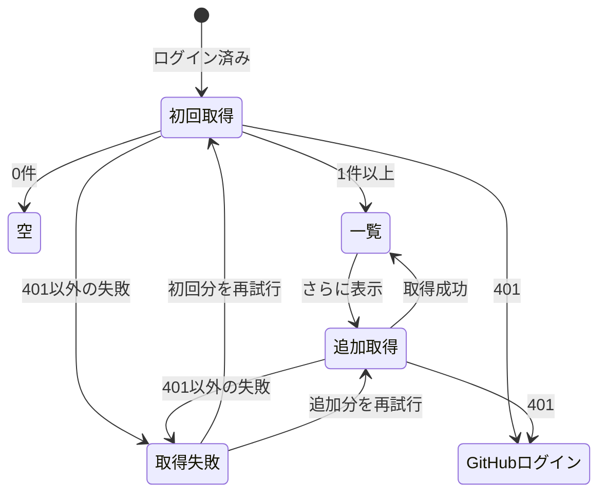

# 学習履歴の一覧画面

API契約は [仕様03](../specs/03-learning-questions.md#アプリ画面用の学習記録api)、サーバーの実装は [Webセッションで学習記録を読む](web-learning-records.md) を参照する。

## 何のためか

Webにログインした本人が、保存した記録からリポジトリ・学習テーマ・保存日時を手がかりに見返す対象を探す。たとえば `owner/repo` で接続トークンを学んだときは、同じ名前のグループから該当のテーマと日時を確認できる。

## 状態の流れ

取得中は読み込みを表示する。追加取得中や失敗時も取得済みの行を表示する。ログアウトやユーザーIDの変更で一覧の状態を破棄し、進行中の取得を中断する。

## 呼び出しの流れ

1. `App.tsx:App` → `auth.ts:fetchMe`。既存のログイン確認後に `LearningHistorySection.tsx:LearningHistorySection` を表示する。
2. `LearningHistorySection.tsx:loadPage` → `learningRecords.ts:listLearningRecords`。WebセッションCookie付きで `GET /web/learning-records` を呼ぶ。初回はAPI既定の20件。続きがあれば `limit=20` と、これまで受け取った件数を `offset` に指定する。
3. `auth/middleware.go:RequireAPIAuth` → `learningrecord/handler_web.go:listWeb` → `learningrecord/handler.go:listPage` → `learningrecord/list.go:Service.List`。認証した本人のIDでSQLの `WHERE user_id = $1` を指定し、記録と `has_more` を返す。
4. `LearningHistorySection.tsx:groupRecords` が取得済みの行をまとめる。401の場合は `LearningHistorySection.tsx:loadPage` → `App.tsx:handleSessionExpired` へ進み、既存のGitHubログイン表示に戻る。

## 関数ごとの表

| 関数 | 目的 | 入力 | 出力 | 更新するもの |
|---|---|---|---|---|
| `listLearningRecords` | Webセッションで一覧を読む | 開始位置、中断シグナル | ページ、401なら `null`、その他の失敗ならエラー | なし |
| `loadPage` | 取得結果を画面へ反映する | リクエストの開始位置 | なし | 取得済みの行、次の開始位置、読み込み・失敗状態 |
| `requestPage` | 追加取得・再試行を始める | 開始位置 | なし | リクエスト、読み込み・失敗状態 |
| `groupRecords` | リポジトリごとに行をまとめる | 取得済みの行 | 表示順のグループ | なし |
| `handleSessionExpired` | 既存のログイン表示へ戻す | なし | なし | `App` のユーザーを `null` にする |

## なぜそうしたか

- ログイン後の単一ページで「PR を取り込む」より上に置く。任意の取り込みを経由せず、学習履歴を先に見つけられる。
- リポジトリ付きのグループは、API順で最初に現れる記録が早い順に並べる。空文字・省略は「リポジトリなし」として末尾に置く。各グループ内はAPIの `created_at DESC, id DESC` を保つ。
- 保存日時は取り込み履歴と同じ `toLocaleString()` で、端末のロケールとタイムゾーンに合わせる。
- 401はWebセッションが使えないというAPIの応答なので、追加の照会を待たず、既存の未ログイン表示に戻す。それ以外の失敗は「再試行」で同じ `offset` を要求できる。
- ページ取得の間に新しい保存があると、オフセットが指す行はずれることがある。同じIDが再び届いた場合は表示を1行に保ち、次の開始位置は応答件数で進める。

## 未決

詳細画面と遷移は PR5。画面のパスは `/learning-records/{id}` を予定する。
