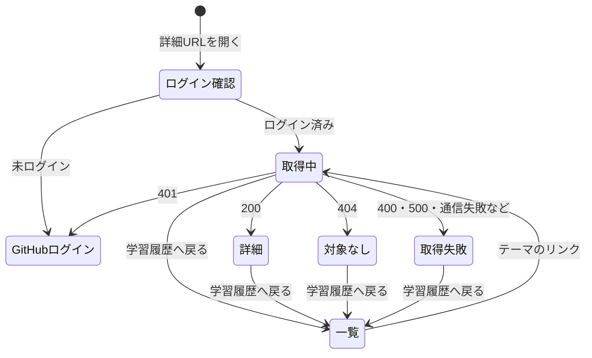

# 学習記録の詳細画面

API契約は [仕様03](../specs/03-learning-questions.md#アプリ画面用の学習記録api) を参照する。

## 何のためか

学習履歴でテーマを選び、保存した問題・回答・解説を見返す。たとえば `owner/repo` の記録を開くと、テーマと保存日時に続き、各問題の回答、ヒント利用、理解度、解説が表示される。回答コードも保存していれば、その問題の中で読める。

## 状態の流れ

## 呼び出しの流れ

1. `App.tsx:App` → `api/auth.ts:fetchMe`。ログイン済みでパスが `/learning-records/{id}` なら `learning/LearningRecordDetailSection.tsx:LearningRecordDetailSection` を表示する。一覧から開くときは `learning/LearningHistorySection.tsx:LearningHistorySection` のテーマリンク → `App.tsx:handleNavigate` でパスを更新する。
2. `learning/LearningRecordDetailSection.tsx:loadRecord` → `api/learningRecords.ts:getLearningRecord`。パスのIDを使い、WebセッションCookie付きで `GET /web/learning-records/{id}` を呼ぶ。
3. `auth/middleware.go:RequireAPIAuth` → `learningrecord/handler_get.go:getRecord` → `learningrecord/query.go:Service.Get`。認証した本人のIDと記録IDで `WHERE id = $1 AND user_id = $2` を指定する。サーバー処理の詳細は [Webセッションで学習記録を読む](web-learning-records.md) を参照する。
4. `learning/LearningRecordDetailSection.tsx:loadRecord` が取得結果を画面へ反映する。401なら `App.tsx:handleSessionExpired` で既存のGitHubログイン表示に戻る。

## 関数ごとの表

| 関数 | 目的 | 入力 | 出力 | 更新するもの |
|---|---|---|---|---|
| `handleNavigate` | 一覧と詳細の間を移動する | リンクのクリック | なし | URL、表示する画面 |
| `getLearningRecord` | Webセッションで1件を読む | パスのID、中断シグナル | 記録、401なら `null`、404なら `"not-found"`、その他はエラー | なし |
| `loadRecord` | 詳細の取得結果を反映する | パスのID | なし | 読み込み状態、401時のログイン状態 |
| `LearningRecordDetailSection` | 記録の本文や取得状態を表示する | パスのID、遷移・セッション切れの処理 | 詳細画面 | なし |

## なぜそうしたか

- クリック時は History API でパスを変える。通常のリンクなので別タブでも開ける。Vite 開発サーバーでは直接開いてもアプリが起動し、ブラウザーの戻る・進むでは `popstate` で表示を合わせる。
- 画面を離れたときやIDが切り替わったときは取得を中断し、遅れて届いた結果は反映しない。「学習履歴へ戻る」は `/` へ移動し、一覧を最初のページから取得する。
- 対象が存在しないときも他人の記録のときも、404では「学習記録が見つかりませんでした」と表示する。
- 不正IDの400 `invalid_record_id` は、一覧と同じエラー処理に沿って「学習記録を取得できませんでした」と表示する。共通の失敗からは一覧へ戻って開き直せる。
- リポジトリ名がなければ詳細の欄を省く。保存日時は一覧と同じ `toLocaleString()` で表示し、回答コードは保存されているときだけ `<pre><code>` で表示する。

## 未決

一覧から実際に保存した記録を見返せることは、ユーザーによる実サーバーでの確認が残る。
