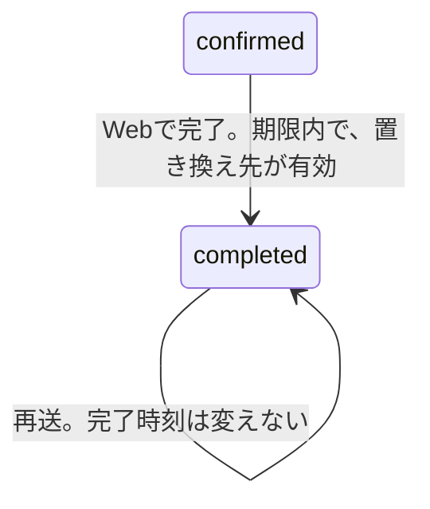

# 再接続の完了

仕様は [07 の再接続API](../specs/07-agent-connection.md) の完了。画面は未実装。確認済みであることと、24時間以内であることと、置き換え先が今も使えることを照合し、旧トークンの失効と完了を同時に書く。用語は [旧トークン](glossary.md#旧トークン)、[置き換え先](glossary.md#置き換え先)。確認の記録は [再接続の確認](reconnect-confirm.md)。

## 何のためか

使う人は、Webにログインした本人。置き換え先で学習記録の一覧が成功したあと、完了を送ったときだけ、旧トークンを失効する。
入力はパスの再接続リクエストID。出力は完了状態。秘密の文字列は出さない。
すでに `completed` への再送は、同じ完了時刻のまま200を返す。新しい失効時刻は書かない。

## 状態の流れ



期限後、未確認、置き換え先が無効、の完了は状態を変えない。409 `reconnection_conflict`。

| きっかけ | 遷移 | DB |
|---|---|---|
| Webの完了。`confirmed` で期限内。置き換え先が有効 | `confirmed` → `completed` | 書く。旧トークンを失効し、`completed_at` を入れる |
| 完了の再送 | `completed` のまま | 同じ完了時刻のまま |
| 期限後の完了。`superseded` や `expired` の行の完了 | 変えない。409 | 書かない |
| 未確認の完了。置き換え先が無効な完了 | 変えない。409 | 書かない |

見る今は2回。置き換え先をロックする前と、ロックしたあと。どちらも `now.Before(期限)` が偽なら409。どちらもマイクロ秒まで切ったUTC。

## 呼び出しの流れ

`POST /connection-reconnections/{id}/complete`。呼び元は [handler.go RegisterRoutes](../../backend/internal/connectiontoken/handler.go)。WebログインとCSRFのあと。`Cache-Control: no-store`。

| 順 | 呼び出し | SQL |
|---|---|---|
| 1 | [handler_reconnect.go Handler.CompleteReconnect](../../backend/internal/connectiontoken/handler_reconnect.go) | なし |
| 2 | 同ファイル `reconnectRequest` | 状態取得と同じ入口。不正なIDは400 `invalid_reconnection_id` |
| 3 | [reconnect.go Service.CompleteReconnect](../../backend/internal/connectiontoken/reconnect.go) | トランザクション開始 |
| 4 | `lockReconnect` → `lockTarget` | 先に `old_token_id` だけ読む。次に旧トークンを `FOR UPDATE`。その後、再接続リクエストを `FOR UPDATE` |
| 5 | すでに `completed` ならここで `Commit` | 追加の更新なし。保存していた `completed_at` を返す |
| 6 | `confirmed` かつ `now.Before(期限)` でなければ | `ErrReconnectConflict`。`Rollback` |
| 7 | `activeReplacement` | 置き換え先を `FOR UPDATE`。失効か、トークン期限ちょうど以降なら409。ロックのあとで時刻を読む |
| 8 | もう一度 `now.Before(期限)` | 待ちのあいだに24時間ちょうどを越えていたら409 |
| 9 | 旧トークンの UPDATE と、再接続リクエストの UPDATE | 旧トークンを失効。状態を `completed`。`completed_at` は7の今 |
| 10 | `writeReconnect` | 200。秘密の文字列は出さない |

`lockReconnect` の取得は、ソースでは1行。意味は次の3段。`reconnectColumns` は開始のノートと同じ列。

```go
query := "SELECT " + reconnectColumns + " FROM connection_reconnections WHERE user_id=$1 AND id=$2 FOR UPDATE"
row := tx.QueryRowContext(ctx, query, userID, id)
got, err := scanReconnect(row)
```

`QueryRowContext` が問い合わせと引数を実行し、行を返す。`scanReconnect` が `row.Scan` を、列の順に呼ぶ。

## 関数ごとの表

| 関数 | 目的 | 入力 | 出力 | 更新するもの |
|---|---|---|---|---|
| [handler_reconnect.go Handler.CompleteReconnect](../../backend/internal/connectiontoken/handler_reconnect.go) | 完了のHTTP入口 | 再接続リクエストのパス | 200 | サービスが、旧トークンと状態を更新する |
| [handler_reconnect.go writeReconnect](../../backend/internal/connectiontoken/handler_reconnect.go) | 完了状態を書く。秘密の文字列は空 | 再接続リクエスト、空の秘密の文字列、200 | なし | なし。空の秘密の文字列はJSONに出さない |
| [reconnect.go lockReconnect](../../backend/internal/connectiontoken/reconnect.go) | 再接続リクエストを、旧トークンの次にロックする | ユーザーID、再接続リクエストID | 再接続リクエストと旧トークン | データは変えない。2行をロックする |
| [reconnect.go activeReplacement](../../backend/internal/connectiontoken/reconnect.go) | 置き換え先が今も使えるか見る。見た時刻を返す | 再接続リクエスト、時刻の関数 | マイクロ秒まで切った今 | データは変えない。置き換え先行をロックする |
| [reconnect.go Service.CompleteReconnect](../../backend/internal/connectiontoken/reconnect.go) | 確認済みを置き換え完了にする | ユーザーID、再接続リクエストID | `Reconnection` | 旧トークンの失効と `completed`。失敗は両方戻る |

`lockReconnect` は、先に `old_token_id` だけ読む。この列は更新しない。その後のロックは、いつも旧トークンが先。`lockTarget` の拒否（未完了の置き換え先を旧トークンにしない）は [再接続の開始](reconnect-start.md)。

## なぜそうしたか

| 選択 | 理由 |
|---|---|
| 完了の再送は更新しない | 同じ完了時刻を返す。2回目の要求で `completed_at` を上書きしない |
| 期限を2回見る | 置き換え先のロック待ちで、24時間ちょうどを越えることがある。待つ前と、待ったあとの両方で見る |
| 時刻は関数で渡す | `activeReplacement` に渡すのは `s.now`。`s.now()` ではない。ロックのあとで `clock()` を呼ぶ。渡す前に `s.now()` すると、待っているあいだの時刻が進まない |
| 完了の旧トークンは `COALESCE` | すでに入っている失効時刻を上書きしない。早い方へ寄せる処理ではない。置き換え先の退役が使う `LEAST` とは違う |
| 失敗は両方戻る | 旧トークンの失効と `completed` は同じトランザクション。途中で return すると `Rollback` で残らない |
| 90日は延ばさない | 置き換え先の期限は発行時のまま。完了は `expires_at` を書かない |

時刻の読み方。`f` は関数、`f()` は今の時刻。

```go
f := s.now // 関数そのもの。まだ時刻を読まない
now := f() // ここで今を読む
```

`CompleteReconnect` は、`activeReplacement` に `s.now` を渡す。`New` は `now: time.Now` を入れる。テストは `s.now = func() time.Time { return 固定時刻 }` に替える。

完了のSQLは、旧トークンに対してこう書く。

```sql
revoked_at = COALESCE(revoked_at, 今)
```

すでに値があれば、その時刻のまま。確認が記録しただけでは、旧トークンは失効しない。失効するのはこの UPDATE。

## 未決

なし。未確認・期限切れ・無効な置き換え先の完了は409で決まっている。画面は未実装。
