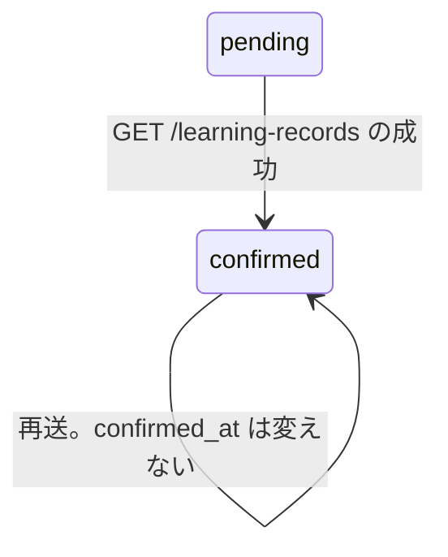

# 再接続の確認

仕様は [07 の再接続API](../specs/07-agent-connection.md) の、新トークンによる一覧成功。画面は未実装。置き換え先で本人の学習記録一覧が成功した事実を、`confirmed` として残す。旧トークンは失効しない。失効は [再接続の完了](reconnect-complete.md)。接続一覧に出ないこととは別で、一覧の除外は [接続一覧](token-list.md)。

## 何のためか

使うのは、置き換え先を渡されたAIツール。Webの管理権限は渡さない。
入力は、そのトークンのユーザーIDとトークンID。`GET /learning-records` が本人の一覧を読めたあとだけ呼ぶ。0件も成功。
更新するのは、`pending` の再接続リクエストだけ。状態を `confirmed` にし、`confirmed_at` を最初の1回だけ入れる。

## 状態の流れ



通常のトークンに、再接続リクエストは作らない。確認の直前に期限切れ、やり直し済み、置き換え先が無効なら、状態は変えない。学習記録一覧は401。旧トークンは失効しない。

| きっかけ | 遷移 | DB |
|---|---|---|
| 置き換え先で `GET /learning-records` が成功。状態は `pending` で期限内 | `pending` → `confirmed` | 書く。`confirmed_at` は最初の1回 |
| 確認の再送。すでに `confirmed` | `confirmed` のまま | 再接続リクエストは変えない |
| すでに `completed` で、置き換え先は有効 | `completed` のまま | 再接続リクエストは変えない。24時間のチェックは両方飛ばす |
| 確認の直前に期限切れ、やり直し済み、置き換え先が無効 | 変えない | 学習記録一覧が401。旧トークンは失効しない |

HEAD、不正なクエリ、保存、詳細取得、旧トークン、別の人のトークンでは確認しない。一覧の取得が失敗したときも確認しない。

## 呼び出しの流れ

`GET /learning-records`。再接続用の別ルートは無い。

| 順 | 呼び出し | SQL |
|---|---|---|
| 1 | [learningrecord/handler.go RegisterRoutes](../../backend/internal/learningrecord/handler.go) | なし。一覧用のハンドラだけがトークンサービスを持つ |
| 2 | [middleware.go RequireToken](../../backend/internal/connectiontoken/middleware.go) | なし。Bearerを読む |
| 3 | [authenticate.go Authenticate](../../backend/internal/connectiontoken/authenticate.go) | ハッシュ、トークン期限、失効。下の `NOT EXISTS` |
| 4 | [learningrecord/handler.go Handler.List](../../backend/internal/learningrecord/handler.go) | 学習記録の一覧。ここが失敗すると確認しない。不正なクエリは400で、確認しない |
| 5 | メソッドが GET のとき [reconnect.go ConfirmReconnect](../../backend/internal/connectiontoken/reconnect.go) | 下の段。応答を書く前 |
| 6 | 置き換え先の再接続リクエストが無ければ return | 通常のトークンは、行を作らない |
| 7 | `lockReconnect` → `activeReplacement` | 旧トークン、再接続リクエスト、置き換え先の順にロック |
| 8 | `pending` のときだけ UPDATE | 状態 `confirmed` と `confirmed_at`。旧トークンは失効しない |

確認が `ErrInvalidToken` なら一覧は401。その他の失敗は500。成功なら200。確認失敗の本体は一覧ではない。

`Authenticate` は、置き換え先に `completed` 以外の再接続リクエストが付いているとき、状態が `pending` でも `confirmed` でもない、または再接続の期限が今以前なら拒否する。`pending` / `confirmed` で期限内なら通す。これが確認の通り道。完了後は、通常の90日と失効だけを見る。接続一覧は、この通り道のトークンも出さない。

```sql
AND NOT EXISTS (
    SELECT 1 FROM connection_reconnections r
    WHERE r.new_token_id = connection_tokens.id
    AND r.state <> 'completed'
    AND (r.state NOT IN ('pending', 'confirmed') OR r.expires_at <= $2)
)
```

`$2` は `s.now().UTC()`。切らない。内側が1行でもあれば、そのトークンは `ErrInvalidToken`。

`ConfirmReconnect` は、ロックの前と、`activeReplacement` のあとで、再接続の24時間を見る。`completed` はこの2回を飛ばす。置き換え先の90日と失効は `activeReplacement` が見る。無効なら `ErrReconnectConflict` を `ErrInvalidToken` に変えて返す。

```go
now, err = activeReplacement(ctx, tx, r, s.now)
```

渡すのは `s.now`。`s.now()` ではない。`activeReplacement` は置き換え先をロックしたあとで `clock()` を呼ぶ。

## 関数ごとの表

| 関数 | 目的 | 入力 | 出力 | 更新するもの |
|---|---|---|---|---|
| [learningrecord/handler.go Handler.List](../../backend/internal/learningrecord/handler.go) | 学習記録一覧。GETの成功だけ確認を呼ぶ | Bearer済みのHTTP | 200、401、500など | 確認が `pending` を `confirmed` にすることがある |
| [authenticate.go Authenticate](../../backend/internal/connectiontoken/authenticate.go) | 秘密の文字列から、使えるトークンを特定する | 秘密の文字列 | `Token` か `ErrInvalidToken` | なし。期限内の `pending` / `confirmed` 以外の未完了置き換え先は拒否する |
| [reconnect.go lockReconnect](../../backend/internal/connectiontoken/reconnect.go) | 再接続リクエストを、旧トークンの次にロックする | ユーザーID、再接続リクエストID | 再接続リクエストと旧トークン | データは変えない。2行をロックする |
| [reconnect.go activeReplacement](../../backend/internal/connectiontoken/reconnect.go) | 置き換え先が今も使えるか見る。見た時刻を返す | 再接続リクエスト、時刻の関数 | マイクロ秒まで切った今 | データは変えない。置き換え先行をロックする。無効は `ErrReconnectConflict` |
| [reconnect.go Service.ConfirmReconnect](../../backend/internal/connectiontoken/reconnect.go) | 一覧成功を記録する。管理権限は渡さない | ユーザーID、置き換え先のトークンID | errorか nil | `pending` だけ `confirmed`。旧トークンは失効しない |

`activeReplacement` が無効を返すと、確認は `ErrInvalidToken` にする。完了は同じ無効を409のまま返す。確認の失敗で旧トークンは失効しない。

## なぜそうしたか

| 選択 | 理由 |
|---|---|
| 一覧GETの成功だけ | 接続成功は、本人の学習記録一覧が正常に返ることで確認する、と仕様07にある。0件も成功。HEAD・保存・詳細は、その確認にしない |
| 応答の前に確認する | 確認が失敗した応答を、一覧の200にしない。401と500は一覧の本体ではない |
| `confirmed_at` は最初の1回 | `pending` のときだけ UPDATE する。再送で確認時刻を動かさない |
| 旧トークンは失効しない | 確認は、サーバーが一覧を返せた事実。Webの完了要求の前に、旧トークンを捨てない |
| 期限を2回見る | 置き換え先のロック待ちで、24時間ちょうどを越えることがある。`completed` は両方飛ばし、代わりに置き換え先の失効と90日を見る |
| 時刻は関数のまま渡す | 渡す前に `s.now()` すると、待っているあいだの時刻が進まない。読み方は [用語集](glossary.md#関数値f-と-f-の違い) |
| 認証と接続一覧で条件が違う | 認証は、期限内の `pending` と `confirmed` を通す。接続一覧は `state <> 'completed'` を全部外す。確認の通り道を、接続の一覧に混ぜない |

定期整理は未実装。追跡は [Issue #46](https://github.com/kushima-takeshi/code-learning-companion/issues/46)。目的: 使用不能後30日を過ぎたトークン情報を、1日1回削除する。24時間ちょうどからの拒否は、この認証と確認が各要求で行う。

## 未決

なし。確認が旧トークンを失効しないことは、上の UPDATE で決まっている。画面は未実装。
