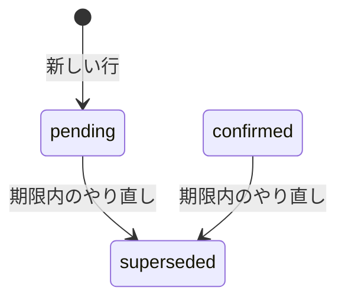

# 再接続のやり直し

仕様は [07 の再接続API](../specs/07-agent-connection.md) のやり直し。画面は [再接続の画面](reconnect-screen.md)。期限内の未完了を捨て、新しい置き換え先と新しい `pending` を同時に作る。用語は [退役](glossary.md#退役)、[置き換え先](glossary.md#置き換え先)。期限後に使える旧トークンへ始める道は [再接続の開始](reconnect-start.md)。表示が `unavailable` でも、期限内ならここへ来られる。

## 何のためか

使う人は、Webにログインした本人。秘密の文字列を失って、同じ再接続を続けられないとき、発行し直す。
入力はパスの、今の再接続リクエストID。出力は新しい再接続リクエストと、秘密の文字列。HTTPは201。
古い再接続リクエストのIDは、もう完了にもやり直しにも使えない。古いIDへもう一度送っても、新しいトークンは出さない。

## 状態の流れ



期限ちょうど以降のやり直しは、状態を変えない。409 `reconnection_conflict`。`completed`、`superseded`、`expired` の行も同じ。置き換え先がすでに失効していても、状態が `pending` か `confirmed` で期限内なら、やり直しは進む。`activeReplacement` は呼ばない。

| きっかけ | 遷移 | DB |
|---|---|---|
| 期限内のやり直し | その行は `superseded`。新しい行が `pending` | 書く。古い置き換え先を失効し、新しい置き換え先を発行する |
| 期限後のやり直し。`superseded` や `expired` や `completed` のやり直し | 変えない。409 | 書かない |

見る今は1回。マイクロ秒まで切ったUTC。`now.Before(期限)` が偽なら、退役しない。

## 呼び出しの流れ

`POST /connection-reconnections/{id}/restart`。呼び元は [handler.go RegisterRoutes](../../backend/internal/connectiontoken/handler.go)。WebログインとCSRFのあと。`Cache-Control: no-store`。

| 順 | 呼び出し | SQL |
|---|---|---|
| 1 | [handler_reconnect.go Handler.RestartReconnect](../../backend/internal/connectiontoken/handler_reconnect.go) | なし |
| 2 | 同ファイル `reconnectRequest` | 完了と同じ入口。不正なIDは400 `invalid_reconnection_id` |
| 3 | [reconnect.go Service.RestartReconnect](../../backend/internal/connectiontoken/reconnect.go) | トランザクション開始 |
| 4 | `lockReconnect` → `lockTarget` | 完了と同じロック順。先に旧トークン |
| 5 | `pending` でも `confirmed` でもない、または期限ちょうど以降 | `ErrReconnectConflict`。`Rollback`。退役しない |
| 6 | `retireReconnect` | 古い置き換え先を失効。状態を `superseded`。時刻は今 |
| 7 | `newReconnect` → [service.go issueToken](../../backend/internal/connectiontoken/service.go) | 新しい置き換え先と、新しい `pending`。名前は旧トークンを写す。置き換え先の期限は90日 |
| 8 | `writeReconnect` | 201。秘密の文字列を返す |

6と7は同じトランザクション。7が失敗すると、6の退役も残らない。

## 関数ごとの表

| 関数 | 目的 | 入力 | 出力 | 更新するもの |
|---|---|---|---|---|
| [handler_reconnect.go Handler.RestartReconnect](../../backend/internal/connectiontoken/handler_reconnect.go) | やり直しのHTTP入口 | 再接続リクエストのパス | 201 | サービスが、古い置き換え先を退役し、新しい行を作る |
| [reconnect.go lockReconnect](../../backend/internal/connectiontoken/reconnect.go) | 再接続リクエストを、旧トークンの次にロックする | ユーザーID、再接続リクエストID | 再接続リクエストと旧トークン | データは変えない。2行をロックする |
| [reconnect.go retireReconnect](../../backend/internal/connectiontoken/reconnect.go) | 置き換え先を使えなくし、再接続リクエストの状態を変える | 再接続リクエスト、次の状態、時刻 | error | 置き換え先の `revoked_at`。ここでは状態を `superseded` |
| [reconnect.go newReconnect](../../backend/internal/connectiontoken/reconnect.go) | `pending` の再接続リクエストと置き換え先を作る | 旧トークン、今 | 再接続リクエストと秘密の文字列 | 置き換え先1行と、再接続リクエスト1行 |
| [reconnect.go Service.RestartReconnect](../../backend/internal/connectiontoken/reconnect.go) | 未完了を捨てて、発行し直す | ユーザーID、再接続リクエストID | `ReconnectResult` | 古い置き換え先の失効、`superseded`、新しい `pending` |

`retireReconnect` を、ここでは退役と呼ぶ。置き換え先を失効し、再接続リクエストの状態を変える。やり直しが渡す時刻は今。期限後の開始が渡す時刻は、再接続リクエストの期限で、状態は `expired`。

```sql
revoked_at = LEAST(COALESCE(revoked_at, 退役時刻), 退役時刻)
```

空なら退役時刻になる。すでに値があれば、その時刻と退役時刻の早い方を残す。遅い方へは動かない。だから、すでに失効している置き換え先のやり直しは、より遅い「今」で `revoked_at` を上書きしない。

## なぜそうしたか

| 選択 | 理由 |
|---|---|
| 古いIDではもう発行しない | 応答を失ったやり直しの再送が、トークンを重ねて出さない。現在の操作へ戻るのは、旧トークンへの開始再送。原本は復元しない |
| 期限内の `pending` と `confirmed` だけ | 仕様07は、やり直しを期限内の未完了に限る。期限後の未完了を退役するのは、開始の仕事 |
| 置き換え先の有効は見ない | 状態取得が `unavailable` と返す行でも、期限内ならやり直しできる、と仕様07にある。`activeReplacement` を通すと、失効済みの置き換え先をやり直せなくなる |
| 退役と新規発行を1つのトランザクションにする | 古い置き換え先だけ失効して、新しい行が無い、を残さない |
| ロックは旧トークンが先 | `lockReconnect` が `old_token_id` を読んでから `lockTarget`。完了と同じ順。詳細は [再接続の完了](reconnect-complete.md) |

部分一意インデックスがあるので、古い行を `superseded` にしてから新しい `pending` を入れる。`pending` のままもう1行は入れられない。

## 未決

なし。期限後のやり直しを拒否することは、上の分岐で決まっている。画面の「やり直す」は実装済み（`ReconnectPanel.tsx`、`ConnectionSection.tsx` の `handleRestart`）。2026-11-12に実Goサーバーで確認済み。
