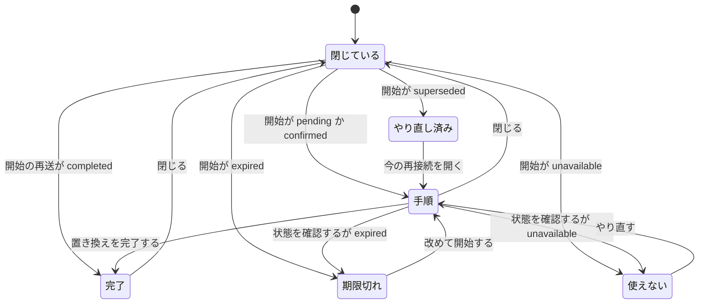

# 再接続の画面

仕様は [07 の再接続API](../specs/07-agent-connection.md)。接続の追加・一覧・失効は [接続画面](connection-screen.md)。サーバーの状態は [再接続の開始](reconnect-start.md)、[再接続の状態取得](reconnect-status.md)、[再接続の完了](reconnect-complete.md)、[再接続のやり直し](reconnect-restart.md)。用語は [原本](glossary.md#原本) と [再接続リクエスト](glossary.md#再接続リクエスト)。

使う人は、Webにログインした本人。使える接続を、一覧取得の成功を確認してから置き換える。学習中には使わない。

## 何のためか

入力は、接続一覧の行が持つトークンID。出力は、その行の下に開く欄。
新しい原本は、開始かやり直しの応答に含まれたときだけ、その欄に出す。状態取得と完了の応答からは出さない。
設定文の雛形と、MCP固有の手順は出さない。

## 状態の流れ

サーバーの状態は保存済みの再接続リクエストが持つ。画面はそれを保存しない。欄を閉じても、サーバーの操作は取り消さない。

| きっかけ | 画面 | サーバー |
|---|---|---|
| 使える行の「再接続」 | その行の下に欄を開く。原本があれば出す | `POST /connection-tokens/{id}/reconnections` |
| 「再接続中」をもう一度、または「閉じる」 | 欄を閉じ、表示中の原本を捨てる | 変えない |
| 「状態を確認する」 | 返った状態を出す。完了は呼ばない | `GET /connection-reconnections/{id}` |
| confirmed の「置き換えを完了する」 | 完了を出し、一覧を読み直す | `POST /connection-reconnections/{id}/complete` |
| 「やり直す」を確認した | 新しい原本に替える | `POST /connection-reconnections/{id}/restart` |
| やり直しの確認を取り消す | そのまま | 変えない |
| expired の「改めて開始する」 | 新しい操作。原本があれば出す | 開始と同じ POST |
| superseded の「今の再接続を開く」 | 今の操作。原本は出ない | 開始の再送 |
| 409 `token_unavailable` | 欄は開かない。追加欄へ同じ名前 | 行も原本も作らない |
| 使えない行 | 「作り直す」だけ。再接続のボタンは無い | 変えない |

`pending` と `confirmed` だけ、手順を4つ出す。完了ボタンは `confirmed` のときだけ。
`completed` は完了の文。`expired` は期限切れの文。`superseded` は開き直すボタン。`unavailable` は「やり直す」。
`pending`、`confirmed`、`completed` 以外では、メモリに残っている原本を出さない。
一定間隔の再取得はしない。確認できた瞬間に完了も呼ばない。

## 呼び出しの流れ

欄は [ConnectionSection.tsx](../../frontend/src/connection/ConnectionSection.tsx) の `li` の中。別ページにもダイアログにもしない。表示の分岐は [ReconnectPanel.tsx](../../frontend/src/connection/ReconnectPanel.tsx)。

### 開始

| 順 | 呼び出し | SQL |
|---|---|---|
| 1 | [ConnectionSection.tsx](../../frontend/src/connection/ConnectionSection.tsx) の `beginReconnect` | なし |
| 2 | [connectionTokens.ts startReconnection](../../frontend/src/api/connectionTokens.ts) | なし。本文なしの POST。Cookie 付き |
| 3 | [handler_reconnect.go Handler.StartReconnect](../../backend/internal/connectiontoken/handler_reconnect.go) | なし |
| 4 | [reconnect.go Service.StartReconnect](../../backend/internal/connectiontoken/reconnect.go) | [再接続の開始](reconnect-start.md) |

状態取得は `handleCheck` から [getReconnection](../../frontend/src/api/connectionTokens.ts)、`GET /connection-reconnections/{id}`、[Handler.GetReconnect](../../backend/internal/connectiontoken/handler_reconnect.go)、[Service.GetReconnect](../../backend/internal/connectiontoken/reconnect.go)。SQLは [再接続の状態取得](reconnect-status.md)。

完了は `handleComplete` から [completeReconnection](../../frontend/src/api/connectionTokens.ts)。`state` が `confirmed` のときだけ呼ぶ。SQLは [再接続の完了](reconnect-complete.md)。

やり直しは `handleRestart` から [restartReconnection](../../frontend/src/api/connectionTokens.ts)。確認を取り消すとここへ進まない。SQLは [再接続のやり直し](reconnect-restart.md)。

409 `token_unavailable` は `beginReconnect` が追加欄の名前をその行の名前にし、入力へ移す。[createConnectionToken](../../frontend/src/api/connectionTokens.ts) は呼ばない。

## 関数ごとの表

| 関数 | 目的 | 入力 | 出力 | 更新するもの |
|---|---|---|---|---|
| `visibleSecret` | 出してよい原本か分ける | `state`、`secret` | 文字列か null | なし |
| `canCompleteReconnect` | 完了ボタンを出すか | `state` | `confirmed` だけ true | なし |
| `canRestartReconnect` | 「やり直す」を出すか | `state` | `pending`、`confirmed`、`unavailable` だけ true | なし |
| `formatReconnectDeadline` | 期限の表示 | `expires_at` | 日本時間の文字列 | なし |
| `startReconnection` | 開始を呼ぶ | トークンID | 再接続リクエストと、あるときだけ原本 | なし。空の `secret` は null |
| `getReconnection` | 状態を読む | 再接続リクエストID | 再接続リクエスト。原本は捨てる | なし |
| `completeReconnection` | 完了を呼ぶ | 再接続リクエストID | 再接続リクエスト | なし |
| `restartReconnection` | やり直しを呼ぶ | 再接続リクエストID | 再接続リクエストと原本 | なし |
| `beginReconnect` | 行から開始する | 一覧の行 | なし | 欄。409なら追加欄の名前 |
| `handleCheck` | 押したときだけ状態を読む | 開いている再接続リクエストID | なし | 欄の状態。完了は呼ばない |
| `handleComplete` | `confirmed` のときだけ完了する | 再接続リクエストID | なし | 欄と一覧 |
| `handleRestart` | 確認のあとやり直す | 再接続リクエストID | なし | 欄の原本 |

## なぜそうしたか

原本は React の state だけに置く。localStorage と sessionStorage には書かない。
状態取得の JSON に `secret` があっても、`getReconnection` は返さない。
完了ボタンは、持っている `state` が `confirmed` のときだけ出す。開始の再送が `confirmed` なら、その応答の時点で出す。押すまで完了は呼ばない。
使える行だけに「再接続」を出す。使えない行は「作り直す」のまま。一覧が有効でも、サーバーが 409 `token_unavailable` なら追加欄へ同じ名前を入れて案内する。発行はしない。
期限は、サーバーの `expires_at` を日本時間にして `JST` と付ける。24時間の計算は画面でしない。
「やり直す」の前に確認する。未完了の新しいトークンを失効するから。欄を閉じるときは確認しない。閉じると原本は捨て、サーバーの操作は残る。
同時に開く欄は1件。別の行を開くと、前の原本は捨てる。サーバーの前の操作は続く。
`expired` はやり直しAPIを呼ばない。「改めて開始する」で開始APIを呼ぶ。`superseded` は開始の再送で今の操作を開く。原本は再表示しない。
文字色と背景は欄の中で指定する。赤は使わない。

## 未決

- 期限を端末のタイムゾーンで出すか。今は日本時間。
- 欄を閉じる前に確認するか。今は確認しない。
- 2026-11-10に、開始から完了まで実Goサーバーで確認済み。やり直しは2026-11-12に実Goサーバーで確認済み。使えない行の409は2026-11-12に実Goサーバーで確認済み。期限切れは未実施。
- 設定文の雛形とMCP。この画面には出さない。
- 全体ブロック2の残り。1つのAIツールからの保存・再取得と、定期整理。
