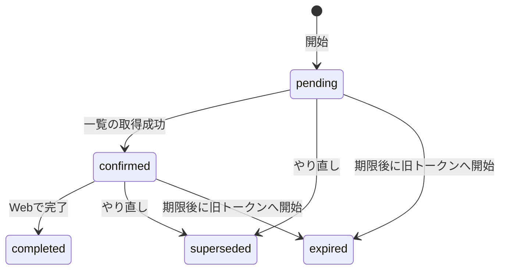

# 再接続の開始

仕様は [07 の再接続API](../specs/07-agent-connection.md)。画面は [再接続の画面](reconnect-screen.md)。用語は [旧トークン](glossary.md#旧トークン)、[置き換え先](glossary.md#置き換え先)、[再接続リクエスト](glossary.md#再接続リクエスト)。保存する状態の全体は下の図。確認は [再接続の確認](reconnect-confirm.md)、完了は [再接続の完了](reconnect-complete.md)、やり直しは [再接続のやり直し](reconnect-restart.md)、表示は [再接続の状態取得](reconnect-status.md)。

保存する状態は `pending` `confirmed` `completed` `superseded` `expired` の5つ。`unavailable` は応答だけの語で、表には書かない。

## 何のためか

使う人は、Webにログインした本人。同じ接続のトークンを差し替えるとき、旧トークンから再接続を始める。
入力はパスの旧トークンID。新規なら置き換え先を発行し、秘密の文字列をこの応答だけ返す。再送なら同じ行を返し、秘密の文字列は空。
期限ちょうど以降、または `revoked_at` がある旧トークンから、新しい再接続は始めない。新しいトークンも再接続リクエストも作らない。

## 状態の流れ

図は、DBに保存する遷移の全体。再送で状態が変わらない道と、応答だけの語は、状態取得のノート。



期限ちょうどから、未完了は期限切れ。`now.Before(期限)` が偽のとき。24時間より前だけ、そのリクエストを続けられる。開始が見る今は、`s.now` をマイクロ秒まで切ったUTC。

| きっかけ | 遷移 | DB |
|---|---|---|
| 初回の開始。進行中も完了もない。旧トークンは使える | なし → `pending` | 書く。置き換え先も発行する |
| 期限内の開始の再送 | `pending` か `confirmed` のまま | 書かない。秘密の文字列は返さない |
| 完了済みへの開始の再送 | `completed` のまま | 書かない。次の再接続は、置き換え先を旧トークンにする |
| 再接続の期限後に、同じ旧トークンへ開始。旧トークンはまだ使える | その行は `expired`。新しい行が `pending` | 書く。失効時刻は期限ちょうど |
| 旧トークンが期限ちょうど以降、または失効済み。返す進行中も完了もない | 変えない。`ErrTokenUnavailable` | 書かない。新しいトークンも行も作らない |
| 再接続の期限後の未完了で、旧トークンも使えない | 変えない。`ErrTokenUnavailable`。[退役](glossary.md#退役)しない | 書かない |
| 未完了・`superseded`・`expired` の置き換え先を、次の旧トークンにして開始 | 変えない。409 | 書かない |

同じ旧トークンの `pending` / `confirmed` / `completed` は1件だけ。部分一意インデックス。`superseded` と `expired` は何件でも残る。`completed` が残るあいだ、その旧トークンへの開始は新しい発行をしない。

## 呼び出しの流れ

`POST /connection-tokens/{id}/reconnections`。呼び元は [handler.go RegisterRoutes](../../backend/internal/connectiontoken/handler.go)。WebログインとCSRFのあと。`Cache-Control: no-store`。パスの `{id}` は旧トークン。SQLは [reconnect.go](../../backend/internal/connectiontoken/reconnect.go) が直接実行する。

| 順 | 呼び出し | SQL |
|---|---|---|
| 1 | [handler_reconnect.go Handler.StartReconnect](../../backend/internal/connectiontoken/handler_reconnect.go) | なし |
| 2 | 同ファイル `reconnectRequest` | なし。未ログインは401。クエリと空白以外の本文は400 `invalid_reconnection_request`。4 KiB超は413 `request_too_large`。UUIDでなければ400 `invalid_token_id` |
| 3 | [reconnect.go Service.StartReconnect](../../backend/internal/connectiontoken/reconnect.go) | トランザクション開始。`defer` の `Rollback` |
| 4 | 同ファイル `lockTarget` | 旧トークンを `FOR UPDATE`。無い、または他人のIDは `ErrTokenNotFound`（404 `token_not_found`）。`state <> 'completed'` の置き換え先なら409 |
| 5 | `StartReconnect` 内の SELECT | ロックのあとで今をマイクロ秒まで切る。その旧トークンの `pending` / `confirmed` / `completed` を1件。`reconnectColumns` |
| 6 | `completed`、または `now.Before(期限)` | `Commit` してその行を返す。秘密の文字列は空。`tokenUnavailable` は見ない |
| 7 | 同ファイル `tokenUnavailable` | 6で戻らなかったとき。期限ちょうど以降か失効なら `ErrTokenUnavailable`。行があっても退役しない。7が偽のときだけ8と9 |
| 8 | 6と7を通過し、行があるときだけ `retireReconnect` | 状態 `expired`。時刻は期限。`revoked_at` は `LEAST`。行が無ければ飛ばす |
| 9 | `newReconnect` → [service.go issueToken](../../backend/internal/connectiontoken/service.go) | 置き換え先を INSERT。期限は90日。再接続リクエストを `pending` で INSERT。期限は今+24時間 |
| 10 | 秘密の文字列が空のときだけ、`Handler.StartReconnect` が `GetReconnect` | 表示用の状態を読み直す。更新しない。詳細は [状態取得](reconnect-status.md) |
| 11 | 同ファイル `writeReconnect` か `reconnectError` | 新規は201。再送は200。使えない旧トークンの新規開始は409 `token_unavailable` |

`Commit` の前に戻ると、そのトランザクションの更新は残らない。`Commit` のあとの `Rollback` は、確定済みを取り消さない。

## 関数ごとの表

| 関数 | 目的 | 入力 | 出力 | 更新するもの |
|---|---|---|---|---|
| [handler.go RegisterRoutes](../../backend/internal/connectiontoken/handler.go) | 再接続4本を、WebログインとCSRFの後ろに載せる | mux、認証、信頼するOrigin | 登録エラーか nil | なし。一覧と失効も同じ保護 |
| [handler_reconnect.go reconnectRequest](../../backend/internal/connectiontoken/handler_reconnect.go) | パスのUUID以外を受け取らない | HTTP。開始はトークンID扱い | ユーザーIDとID。不可なら処理済み | なし。401、400、413を書く |
| [handler_reconnect.go reconnectError](../../backend/internal/connectiontoken/handler_reconnect.go) | サービスエラーを短いコードにする | error | なし | なし。`ErrTokenNotFound` は404 `token_not_found`。`ErrReconnectNotFound` は404 `reconnection_not_found`。`ErrReconnectConflict` は409 `reconnection_conflict`。`ErrTokenUnavailable` は409 `token_unavailable`。ほかは500 |
| [handler_reconnect.go Handler.StartReconnect](../../backend/internal/connectiontoken/handler_reconnect.go) | 開始のHTTP入口 | 旧トークンのパス | 201か200。使えない新規開始は409 | サービスが更新する。再送は `GetReconnect` で表示を揃える。拒否は何も書かない |
| [service.go New](../../backend/internal/connectiontoken/service.go) | サービスを作る。時刻は `time.Now` | DB | `*Service` | なし。`now` は後からテストが差し替える |
| [service.go issueToken](../../backend/internal/connectiontoken/service.go) | 置き換え先を発行する。通常発行も同じ関数 | ユーザーID、接続名、作成時刻 | トークンと秘密の文字列 | `connection_tokens` に1行。期限は90日。原本は保存しない |
| [reconnect.go scanReconnect](../../backend/internal/connectiontoken/reconnect.go) | 再接続リクエストの1行を構造体へ写す | `Scan` できる行 | `Reconnection` | なし。時刻のNULLは nil |
| [reconnect.go lockTarget](../../backend/internal/connectiontoken/reconnect.go) | 同じ旧トークンの処理を、1本ずつにする | ユーザーID、旧トークンID | 旧トークン。無ければ `ErrTokenNotFound`。`completed` 以外の置き換え先なら `ErrReconnectConflict` | データは変えない。旧トークン行をロックする |
| [reconnect.go newReconnect](../../backend/internal/connectiontoken/reconnect.go) | `pending` の再接続リクエストと置き換え先を作る | 旧トークン、今 | 再接続リクエストと秘密の文字列 | 置き換え先1行と、再接続リクエスト1行。名前は旧トークンを写す |
| [reconnect.go tokenUnavailable](../../backend/internal/connectiontoken/reconnect.go) | 旧トークンが今も使えるか見る | 旧トークン、今 | 使えないなら true | なし。`revoked_at` がある、または期限ちょうど以降 |
| [reconnect.go Service.StartReconnect](../../backend/internal/connectiontoken/reconnect.go) | 開始。再送は同じ行を返し、秘密の文字列は空 | ユーザーID、旧トークンID | `ReconnectResult` | 使える旧トークンの新規か、使えるときの退役と新規。使えない新規開始は拒否し、何も書かない。再送は更新しない |

`lockTarget` は、旧トークンの期限と失効を条件にしない。確認・完了・やり直しもここを通る。新規開始の拒否は `StartReconnect` が、再送を返したあとに行う。

`reconnectColumns` は `id, user_id, old_token_id, new_token_id, state, created_at, expires_at, confirmed_at, completed_at`。開始の取得は、意味として次の3段。

```go
query := "SELECT " + reconnectColumns + " FROM connection_reconnections WHERE old_token_id=$1 AND state IN ('pending','confirmed','completed')"
row := tx.QueryRowContext(ctx, query, oldID)
current, err := scanReconnect(row)
```

## なぜそうしたか

| 選択 | 理由 |
|---|---|
| 再接続リクエストを別表にした | 捨てた行を残したまま、`pending` / `confirmed` / `completed` だけ旧トークンにつき1件にするため。制約は [マイグレーション6](../../backend/migrations/000006_connection_reconnections.up.sql) |
| ロックは旧トークンが先 | 開始の時点では再接続リクエストの行が無い。全員が先に旧トークン行を待つ。その後に再接続リクエスト、必要なとき置き換え先 |
| 使えない旧トークンの拒否は `StartReconnect` | 新しい操作を作る直前だけ見る。`lockTarget` に置くと、失効済み旧トークンの完了や、24時間以内のやり直しまで落ちる |
| 再送を拒否より前に返す | 仕様07は、進行中の再送と完了済みの遅延再送を返す、と書く。完了は旧トークンを失効するので、失効済みを一律に拒否すると遅延再送が届かない。中断後に操作IDへ戻る再送も、新しいトークンを出さない |
| 期限後かつ旧トークンも使えないときは退役しない | 期限後の未完了は退役して新しい `pending` を作る、という文と、使えない旧トークンは行を作らない、という文の重なり。仕様07にこの重なりの一文は無い。実装は `ErrTokenUnavailable` で戻り、置き換え先の `revoked_at` も状態も変えない |
| `completed` 以外の置き換え先を、次の旧トークンにしない | `pending`、`confirmed`、`superseded`、`expired` が対象で、`lockTarget` が409を返す。完了側は「旧トークン → 置き換え先」、開始側が「置き換え先 → その親の旧トークン」と逆にロックすると、互いを待ち続ける。拒否するので、その輪を作らない |
| 期限後の退役時刻は「今」ではない | 使えなくなった時点は、再接続リクエストの期限。`retireReconnect` に渡すのは `current.ExpiresAt` |
| 退役は `LEAST` | 置き換え先は、使えなくなった早い時刻を残す。空なら退役時刻。すでに値があれば、その時刻と退役時刻の早い方。遅い方へは動かない |
| 列名を1か所にまとめる | SELECT、INSERT の RETURNING、`Scan` の順を揃える。順が崩れると別のフィールドに入る |

退役のSQLは、置き換え先に対してこう書く。やり直しも同じ文で、渡す状態と時刻が違う。

```sql
revoked_at = LEAST(COALESCE(revoked_at, 退役時刻), 退役時刻)
```

旧トークンがその後に期限切れや失効になっていても、6の再送は返す。これは仕様に無い判断。画面は [再接続の画面](reconnect-screen.md)。`token_unavailable` のときは「作り直す」へ案内し、追加画面を同じ接続名を入れた状態で開く、と仕様07にある。

## 未決

なし。PR #29 のレビューのうち、使えない旧トークンからの新規開始は上の振る舞いで決まっている。一覧の見せ方は [接続一覧](token-list.md)。画面の「作り直す」は [接続画面](connection-screen.md)。409からの案内は [再接続の画面](reconnect-screen.md)。
