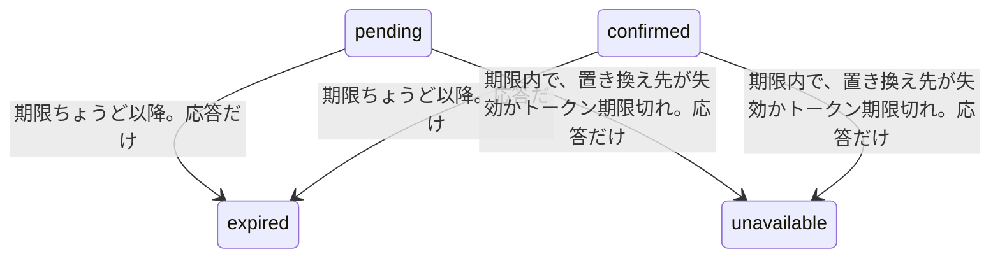

# 再接続の状態取得

仕様は [07 の再接続API](../specs/07-agent-connection.md) の状態取得。画面は [再接続の画面](reconnect-screen.md)。開始が再送で同じ行を返すときも、この読み方で表示を揃える。用語は [再接続リクエスト](glossary.md#再接続リクエスト)。保存する遷移の全体は [再接続の開始](reconnect-start.md)。

## 何のためか

使う人は、Webにログインした本人。中断した再接続の状態を、DBを変えずに読む。
入力はパスの再接続リクエストID。出力は、表示用の状態。秘密の文字列は出さない。
期限切れと、置き換え先の失効は、掃除ジョブを使わず、この読み取りの CASE で返す。

## 状態の流れ

保存する状態は変えない。`pending` と `confirmed` だけ、応答の語が保存と違うことがある。



`unavailable` は応答だけの語で、表には書かない。CASE は期限切れを先に見る。期限超過かつ置き換え先も失効なら、応答は `expired`。`unavailable` ではない。`completed`、`superseded`、`expired` は、保存した語のまま。

比較に渡す今は、`s.now().UTC()`。マイクロ秒未満は切らない。開始が書く時刻は切る。この差は状態取得と開始で揃えていない。

| きっかけ | 遷移 | DB |
|---|---|---|
| `pending` か `confirmed` で、期限ちょうど以降 | 応答だけ `expired` | 書かない。行は元の状態のまま |
| 期限内だが、置き換え先が失効か、トークン期限切れ | 応答だけ `unavailable` | 書かない。やり直しはできる。手順は [再接続のやり直し](reconnect-restart.md) |
| それ以外 | 保存した状態 | 書かない |

## 呼び出しの流れ

`GET /connection-reconnections/{id}`。呼び元は [handler.go RegisterRoutes](../../backend/internal/connectiontoken/handler.go)。WebログインとCSRFのあと。`Cache-Control: no-store`。パスの `{id}` は再接続リクエスト。

| 順 | 呼び出し | SQL |
|---|---|---|
| 1 | [handler_reconnect.go Handler.GetReconnect](../../backend/internal/connectiontoken/handler_reconnect.go) | なし |
| 2 | 同ファイル `reconnectRequest` | 開始と同じ入口。不正なIDのコードは `invalid_reconnection_id`。未ログインは401。クエリと空白以外の本文は400。4 KiB超は413 |
| 3 | [reconnect.go Service.GetReconnect](../../backend/internal/connectiontoken/reconnect.go) | 再接続リクエストと置き換え先を、1文の SELECT で読む。`state` の位置に CASE |
| 4 | 同ファイル `writeReconnect` | なし。200。秘密の文字列は出さない |

`GetReconnect` の呼び元は、このハンドラと、開始の再送。開始の再送は、サービスが返した保存状態を、この CASE で読み直してから書く。

`GetReconnect` は `reconnectColumns` を使わない。`state` の位置に CASE を置き、同じ `scanReconnect` で読む。列の順は `id, user_id, old_token_id, new_token_id, state, created_at, expires_at, confirmed_at, completed_at`。

```go
query := `
    SELECT r.id, r.user_id, r.old_token_id, r.new_token_id,
    CASE WHEN r.state IN ('pending','confirmed') AND r.expires_at <= $3 THEN 'expired'
         WHEN r.state IN ('pending','confirmed') AND (t.revoked_at IS NOT NULL OR t.expires_at <= $3) THEN 'unavailable'
         ELSE r.state END,
    r.created_at, r.expires_at, r.confirmed_at, r.completed_at
    FROM connection_reconnections r
    JOIN connection_tokens t ON t.id = r.new_token_id
    WHERE r.user_id = $1 AND r.id = $2
`
row := s.db.QueryRowContext(ctx, query, userID, id, s.now().UTC())
got, err := scanReconnect(row)
```

`QueryRowContext` が問い合わせと引数を実行し、行を返す。`scanReconnect` が `row.Scan` を、列の順に呼ぶ。`confirmed_at` と `completed_at` はポインタなので、NULLは nil。0行は `ErrReconnectNotFound`。HTTPは404 `reconnection_not_found`。

## 関数ごとの表

| 関数 | 目的 | 入力 | 出力 | 更新するもの |
|---|---|---|---|---|
| [handler_reconnect.go reconnectRequest](../../backend/internal/connectiontoken/handler_reconnect.go) | パスのUUID以外を受け取らない | HTTP。状態取得は再接続リクエストID | ユーザーIDとID。不可なら処理済み | なし。401、400、413を書く |
| [handler_reconnect.go publicReconnect](../../backend/internal/connectiontoken/handler_reconnect.go) | 応答に出してよい項目だけにする | 再接続リクエスト | JSON用の構造体 | なし。所有者もハッシュも出さない |
| [handler_reconnect.go writeReconnect](../../backend/internal/connectiontoken/handler_reconnect.go) | 再接続リクエストと、あるときだけ秘密の文字列を書く | 再接続リクエスト、秘密の文字列、status | なし | なし。空の秘密の文字列はJSONに出さない |
| [handler_reconnect.go Handler.GetReconnect](../../backend/internal/connectiontoken/handler_reconnect.go) | 状態取得のHTTP入口 | 再接続リクエストのパス | 200 | なし |
| [reconnect.go scanReconnect](../../backend/internal/connectiontoken/reconnect.go) | 再接続リクエストの1行を構造体へ写す | `Scan` できる行 | `Reconnection` | なし。時刻のNULLは nil |
| [reconnect.go Service.GetReconnect](../../backend/internal/connectiontoken/reconnect.go) | 表示用の状態を読む。掃除ジョブは使わない | ユーザーID、再接続リクエストID | `Reconnection` | なし |

応答の項目は `id`、`old_token_id`、`new_token_id`、`state`、`created_at`、`expires_at`、`confirmed_at`、`completed_at`。未設定の日時は null。`writeReconnect` の秘密の文字列は `omitempty` なので、空なら項目自体が無い。

## なぜそうしたか

| 選択 | 理由 |
|---|---|
| DBを更新しない | 期限切れの表示のために、読み取りで退役しない。退役は、使える旧トークンへの次の開始が行う。手順は [再接続の開始](reconnect-start.md) |
| 期限切れを CASE の先に置く | 期限超過かつ置き換え先も失効なら、応答は `expired`。`unavailable` にすると、期限後の行がやり直しできる形に見える |
| 1文の SELECT | 再接続リクエストの状態と、置き換え先の失効・期限を、同じスナップショットで読む |
| 開始の再送もここを通す | サービスが返すのは保存した状態。置き換え先が期限内に失効している再送を、`unavailable` と揃える |
| 今を切らない | 書き込む時刻はマイクロ秒未満を切る。状態取得の比較は、切らずにUTCのまま。境界の1マイクロ秒未満は、開始と表示で違うことがあり得る |

`unavailable` の行は、期限内ならやり直しできる。状態取得はそのやり直しを実行しない。

## 未決

なし。表示だけの `expired` と `unavailable` は、上の CASE で決まっている。掃除ジョブは無い。画面は [再接続の画面](reconnect-screen.md)。
