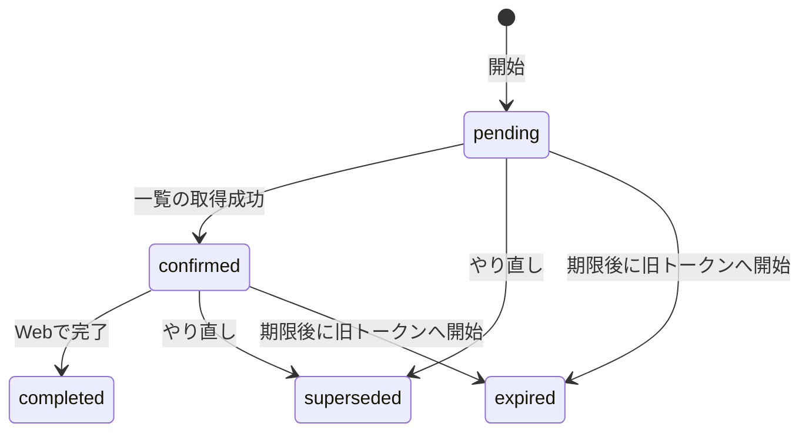

# 再接続の学習ノート

仕様は [07 の再接続API](../specs/07-agent-connection.md)。画面は未実装。コードは `connectiontoken` と、学習記録一覧の確認。用語はこの3つに固定する。

| 用語 | コード |
|---|---|
| 旧トークン | `old_token_id`。差し替える接続 |
| 置き換え先(新トークン) | `new_token_id`。秘密の文字列は、新規発行の応答だけ |
| 再接続リクエスト | 表 `connection_reconnections` の1行。型は `Reconnection` |

保存する状態は `pending` `confirmed` `completed` `superseded` `expired` の5つ。`unavailable` は応答だけの語で、表には書かない。

## 1. この機能は何のためか

使う人は、Webにログインした本人。AIツールは、渡された置き換え先で学習記録を読むだけ。
使うとき: 同じ接続のトークンを差し替えるとき。再接続リクエストは、開始から24時間。
置き換え先で学習記録の一覧取得が成功したあと、本人が完了を送ったときだけ、旧トークンを失効する。

## 2. 状態の流れ

図は、DBに保存する遷移だけ。再送で状態が変わらない道と、応答だけの語は、下の表。



期限ちょうどから、未完了は期限切れ。`now.Before(期限)` が偽のとき。24時間より前だけ、そのリクエストを続けられる。

| きっかけ | 遷移 | DB |
|---|---|---|
| 初回の開始。進行中も完了もない | なし → `pending` | 書く。置き換え先も発行する |
| 期限内の開始の再送 | `pending` か `confirmed` のまま | 書かない。秘密の文字列は返さない |
| 完了済みへの開始の再送 | `completed` のまま | 書かない。次の再接続は、置き換え先を旧トークンにする |
| 置き換え先で `GET /learning-records` が成功 | `pending` → `confirmed` | 書く。`confirmed_at` は最初の1回 |
| 確認の再送 | `confirmed` のまま | 再接続リクエストは変えない |
| Webの完了。期限内で、置き換え先が有効 | `confirmed` → `completed` | 書く。旧トークンを失効し、`completed_at` を入れる |
| 完了の再送 | `completed` のまま | 同じ完了時刻のまま |
| 期限内のやり直し | その行は `superseded`。新しい行が `pending` | 書く。古い置き換え先を失効し、新しい置き換え先を発行する |
| 期限後に、同じ旧トークンへ開始 | その行は `expired`。新しい行が `pending` | 書く。失効時刻は期限ちょうど |
| 状態取得。`pending` か `confirmed` で期限ちょうど以降 | 応答だけ `expired` | 書かない。行は元の状態のまま |
| 状態取得。期限内だが、置き換え先が失効か、トークン期限切れ | 応答だけ `unavailable` | 書かない。やり直しはできる |
| 期限後の完了とやり直し。`superseded` や `expired` の行の完了・やり直し | 変えない。409 | 書かない |
| 未確認の完了。置き換え先が無効な完了 | 変えない。409 | 書かない |
| 未完了・`superseded`・`expired` の置き換え先を、次の旧トークンにして開始 | 変えない。409 | 書かない |
| 確認の直前に期限切れ、やり直し済み、置き換え先が無効 | 変えない | 学習記録一覧が 401。旧トークンは失効しない |

状態取得の CASE は、期限切れを先に見る。期限超過かつ置き換え先も失効なら、応答は `expired`。`unavailable` ではない。

同じ旧トークンの `pending` / `confirmed` / `completed` は1件だけ。部分一意インデックス。`superseded` と `expired` は何件でも残る。`completed` が残るあいだ、その旧トークンへの開始は新しい発行をしない。

## 3. 呼び出しの流れ

管理APIは4本。どれも Webログインと、既存のCSRF保護のあと。登録は [handler.go の RegisterRoutes](../../backend/internal/connectiontoken/handler.go)。確認だけは、学習記録の一覧GETから入る。再接続用の別 repository ファイルはない。SQLは [reconnect.go](../../backend/internal/connectiontoken/reconnect.go) が直接実行する。テストからの呼び出しは省く。

### 開始 `POST /connection-tokens/{id}/reconnections`

呼び元は `RegisterRoutes`。パスの `{id}` は旧トークン。

| 順 | 呼び出し | SQL |
|---|---|---|
| 1 | [handler_reconnect.go Handler.StartReconnect](../../backend/internal/connectiontoken/handler_reconnect.go) | なし |
| 2 | 同ファイル `reconnectRequest` | なし。未ログインは401。クエリと空白以外の本文は400。4 KiB超は413。UUIDでなければ400 |
| 3 | [reconnect.go Service.StartReconnect](../../backend/internal/connectiontoken/reconnect.go) | トランザクション開始 |
| 4 | 同ファイル `lockTarget` | 旧トークンを `FOR UPDATE`。無ければ `ErrTokenNotFound`（HTTPは404）。`completed` 以外の置き換え先なら409 |
| 5 | 同ファイル `StartReconnect` 内の SELECT | その旧トークンの `pending` / `confirmed` / `completed` を1件読む |
| 6 | 期限切れなら `retireReconnect` | 置き換え先の `revoked_at` と、状態 `expired` |
| 7 | 新規なら `newReconnect` → [service.go issueToken](../../backend/internal/connectiontoken/service.go) | 置き換え先を INSERT。再接続リクエストを `pending` で INSERT |
| 8 | 秘密の文字列が空の再送だけ、`Handler.StartReconnect` が `GetReconnect` | 表示用の状態を読み直す。更新しない |
| 9 | 同ファイル `writeReconnect` か `reconnectError` | なし。新規は201。再送は200 |

### 状態取得 `GET /connection-reconnections/{id}`

呼び元は `RegisterRoutes`。パスの `{id}` は再接続リクエスト。

| 順 | 呼び出し | SQL |
|---|---|---|
| 1 | [handler_reconnect.go Handler.GetReconnect](../../backend/internal/connectiontoken/handler_reconnect.go) | なし |
| 2 | `reconnectRequest` | 開始と同じ。不正なIDのコードは `invalid_reconnection_id` |
| 3 | [reconnect.go Service.GetReconnect](../../backend/internal/connectiontoken/reconnect.go) | 再接続リクエストと置き換え先を、1文の SELECT で読む。CASE で表示状態を出す |
| 4 | `writeReconnect` | なし。200。秘密の文字列は出さない |

`GetReconnect` の呼び元は、このハンドラと、開始の再送。

### 完了 `POST /connection-reconnections/{id}/complete`

呼び元は `RegisterRoutes`。

| 順 | 呼び出し | SQL |
|---|---|---|
| 1 | [handler_reconnect.go Handler.CompleteReconnect](../../backend/internal/connectiontoken/handler_reconnect.go) | なし |
| 2 | `reconnectRequest` | 状態取得と同じ入口 |
| 3 | [reconnect.go Service.CompleteReconnect](../../backend/internal/connectiontoken/reconnect.go) | トランザクション開始 |
| 4 | `lockReconnect` → `lockTarget` | 先に旧トークンIDを読む。次に旧トークンを `FOR UPDATE`。その後、再接続リクエストを `FOR UPDATE` |
| 5 | すでに `completed` ならここで COMMIT | 追加の更新なし |
| 6 | `activeReplacement` | 置き換え先を `FOR UPDATE`。無効なら409 |
| 7 | 旧トークンの UPDATE と、再接続リクエストの UPDATE | 旧トークンを失効。状態を `completed` |
| 8 | `writeReconnect` | 200。秘密の文字列は出さない |

### やり直し `POST /connection-reconnections/{id}/restart`

呼び元は `RegisterRoutes`。

| 順 | 呼び出し | SQL |
|---|---|---|
| 1 | [handler_reconnect.go Handler.RestartReconnect](../../backend/internal/connectiontoken/handler_reconnect.go) | なし |
| 2 | `reconnectRequest` | 完了と同じ入口 |
| 3 | [reconnect.go Service.RestartReconnect](../../backend/internal/connectiontoken/reconnect.go) | トランザクション開始 |
| 4 | `lockReconnect` → `lockTarget` | 完了と同じロック順 |
| 5 | `retireReconnect` | 古い置き換え先を失効。状態を `superseded` |
| 6 | `newReconnect` → `issueToken` | 新しい置き換え先と、新しい `pending` |
| 7 | `writeReconnect` | 201。秘密の文字列を返す。古い再接続リクエストのIDは、もう使えない |

### 確認 `GET /learning-records`

置き換え先で、本人の学習記録一覧が成功したときだけ。0件も成功。HEAD、不正なクエリ、保存、詳細取得、旧トークン、別の人のトークンでは確認しない。

| 順 | 呼び出し | SQL |
|---|---|---|
| 1 | [learningrecord/handler.go RegisterRoutes](../../backend/internal/learningrecord/handler.go) | なし。一覧用のハンドラだけがトークンサービスを持つ |
| 2 | [middleware.go RequireToken](../../backend/internal/connectiontoken/middleware.go) | なし。Bearerを読む |
| 3 | [authenticate.go Authenticate](../../backend/internal/connectiontoken/authenticate.go) | ハッシュ、トークン期限、失効。期限内の `pending` / `confirmed` だけ、未完了の置き換え先を通す |
| 4 | [learningrecord/handler.go Handler.List](../../backend/internal/learningrecord/handler.go) | 学習記録の一覧。ここが失敗すると確認しない |
| 5 | メソッドが GET のとき [reconnect.go ConfirmReconnect](../../backend/internal/connectiontoken/reconnect.go) | 下の段 |
| 6 | 置き換え先の再接続リクエストが無ければ return | 通常のトークンは、行を作らない |
| 7 | `lockReconnect` → `activeReplacement` | 旧トークン、再接続リクエスト、置き換え先の順にロック |
| 8 | `pending` のときだけ UPDATE | 状態 `confirmed` と `confirmed_at`。旧トークンは失効しない |

確認が `ErrInvalidToken` なら一覧は401。その他の失敗は500。成功なら200。応答を書く前に確認するので、確認失敗の本体は一覧ではない。

`Authenticate` は、置き換え先に `completed` 以外の再接続リクエストが付いているとき、状態が `pending` でも `confirmed` でもない、または再接続の期限が今以前なら拒否する。`pending` / `confirmed` で期限内なら通す。これが確認の通り道。完了後は、通常の90日と失効だけを見る。

### 接続一覧 `GET /connection-tokens`

作り終えていない鍵を、接続の一覧に出さない。
入力は、WebログインのユーザーID。
出力は本人のトークンで、行は更新しない。

1. [handler.go Handler.List](../../backend/internal/connectiontoken/handler.go) が、Webログインのあとでサービスを呼ぶ。
2. [manage.go Service.List](../../backend/internal/connectiontoken/manage.go) が、本人の `connection_tokens` を新しい順で読む。
3. `new_token_id` が、`state` が `completed` でない再接続リクエストの行を外す。24時間以内の `pending` と `confirmed` も外す。`superseded` と `expired` も外す。
4. 残った行を `scanToken` で `Token` にする。完了した置き換え先は残る。使えるかは `expires_at` と `revoked_at`。
5. `Handler.List` が `id`、`name`、`created_at`、`expires_at`、`revoked_at` だけを返す。再接続の状態は足さない。

```go
query := `
    SELECT id, user_id, name, created_at, expires_at, revoked_at
    FROM connection_tokens
    WHERE user_id=$1
    AND NOT EXISTS (
        SELECT 1 FROM connection_reconnections r
        WHERE r.new_token_id=connection_tokens.id AND r.state <> 'completed'
    )
    ORDER BY created_at DESC, id DESC
`
rows, err := s.db.QueryContext(ctx, query, userID)
for rows.Next() {
    token, err := scanToken(rows)
}
```

`QueryContext` が問い合わせと、引数のユーザーIDを実行する。`scanToken` が各行の `Scan` を呼ぶ。[NOT EXISTS](glossary.md#not-exists) は、内側が1行も無いトークンだけを残す。旧トークンは `new_token_id` ではないので残る。

認証はこの問い合わせを使わない。期限内の `pending` と `confirmed` は、一覧に出なくても学習記録APIでは通る。

## 4. 関数ごとの表

列は同じ。上はHTTP、下はサービスとSQL。1行が1関数。

| 関数 | 目的 | 入力 | 出力 | 更新するもの |
|---|---|---|---|---|
| [handler.go RegisterRoutes](../../backend/internal/connectiontoken/handler.go) | 4本の再接続ルートを、WebログインとCSRFの後ろに載せる | mux、認証、信頼するOrigin | 登録エラーか nil | なし |
| [handler_reconnect.go reconnectRequest](../../backend/internal/connectiontoken/handler_reconnect.go) | パスのUUID以外を受け取らない | HTTP。開始ならトークンID扱い | ユーザーIDとID。不可なら処理済み | なし。401、400、413を書く |
| [handler_reconnect.go reconnectError](../../backend/internal/connectiontoken/handler_reconnect.go) | サービスエラーを短いコードにする | error | なし | なし。404、409、ほかは500 |
| [handler_reconnect.go publicReconnect](../../backend/internal/connectiontoken/handler_reconnect.go) | 応答に出してよい項目だけにする | 再接続リクエスト | JSON用の構造体 | なし。所有者もハッシュも出さない |
| [handler_reconnect.go writeReconnect](../../backend/internal/connectiontoken/handler_reconnect.go) | 再接続リクエストと、あるときだけ秘密の文字列を書く | 再接続リクエスト、秘密の文字列、status | なし | なし。空の秘密の文字列はJSONに出さない |
| [handler_reconnect.go Handler.StartReconnect](../../backend/internal/connectiontoken/handler_reconnect.go) | 開始のHTTP入口 | 旧トークンのパス | 201か200 | サービスが更新する。再送は `GetReconnect` で表示を揃える |
| [handler_reconnect.go Handler.GetReconnect](../../backend/internal/connectiontoken/handler_reconnect.go) | 状態取得のHTTP入口 | 再接続リクエストのパス | 200 | なし |
| [handler_reconnect.go Handler.CompleteReconnect](../../backend/internal/connectiontoken/handler_reconnect.go) | 完了のHTTP入口 | 再接続リクエストのパス | 200 | サービスが、旧トークンと状態を更新する |
| [handler_reconnect.go Handler.RestartReconnect](../../backend/internal/connectiontoken/handler_reconnect.go) | やり直しのHTTP入口 | 再接続リクエストのパス | 201 | サービスが、古い置き換え先を退役し、新しい行を作る |
| [learningrecord/handler.go Handler.List](../../backend/internal/learningrecord/handler.go) | 学習記録一覧。GETの成功だけ確認を呼ぶ | Bearer済みのHTTP | 200、401、500など | 確認が `pending` を `confirmed` にすることがある |
| [service.go New](../../backend/internal/connectiontoken/service.go) | サービスを作る。時刻は `time.Now` | DB | `*Service` | なし。`now` は後からテストが差し替える |
| [service.go issueToken](../../backend/internal/connectiontoken/service.go) | 置き換え先を発行する。通常発行も同じ関数 | ユーザーID、接続名、作成時刻 | トークンと秘密の文字列 | `connection_tokens` に1行。期限は90日。原本は保存しない |
| [service.go scanToken](../../backend/internal/connectiontoken/service.go) | トークンの1行を構造体へ写す | `Scan` できる行 | `Token` | なし |
| [reconnect.go scanReconnect](../../backend/internal/connectiontoken/reconnect.go) | 再接続リクエストの1行を構造体へ写す | `Scan` できる行 | `Reconnection` | なし。時刻のNULLは nil |
| [reconnect.go lockTarget](../../backend/internal/connectiontoken/reconnect.go) | 同じ旧トークンの処理を、1本ずつにする | ユーザーID、旧トークンID | 旧トークン。無ければ `ErrTokenNotFound`。`completed` 以外の置き換え先なら `ErrReconnectConflict` | データは変えない。旧トークン行をロックする |
| [reconnect.go lockReconnect](../../backend/internal/connectiontoken/reconnect.go) | 再接続リクエストを、旧トークンの次にロックする | ユーザーID、再接続リクエストID | 再接続リクエストと旧トークン | データは変えない。2行をロックする |
| [reconnect.go newReconnect](../../backend/internal/connectiontoken/reconnect.go) | `pending` の再接続リクエストと置き換え先を作る | 旧トークン、今 | 再接続リクエストと秘密の文字列 | 置き換え先1行と、再接続リクエスト1行。名前は旧トークンを写す |
| [reconnect.go retireReconnect](../../backend/internal/connectiontoken/reconnect.go) | 置き換え先を使えなくし、再接続リクエストの状態を変える | 再接続リクエスト、次の状態、時刻 | error | 置き換え先の `revoked_at`。状態を `superseded` か `expired` |
| [reconnect.go activeReplacement](../../backend/internal/connectiontoken/reconnect.go) | 置き換え先が今も使えるか見る。見た時刻を返す | 再接続リクエスト、時刻の関数 | マイクロ秒まで切った今 | データは変えない。置き換え先行をロックする |
| [reconnect.go Service.StartReconnect](../../backend/internal/connectiontoken/reconnect.go) | 開始。再送は同じ行を返し、秘密の文字列は空 | ユーザーID、旧トークンID | `ReconnectResult` | 新規か、期限切れの退役と新規。再送は更新しない |
| [reconnect.go Service.GetReconnect](../../backend/internal/connectiontoken/reconnect.go) | 表示用の状態を読む。掃除ジョブは使わない | ユーザーID、再接続リクエストID | `Reconnection` | なし |
| [reconnect.go Service.ConfirmReconnect](../../backend/internal/connectiontoken/reconnect.go) | 一覧成功を記録する。管理権限は渡さない | ユーザーID、置き換え先のトークンID | errorか nil | `pending` だけ `confirmed`。旧トークンは失効しない |
| [reconnect.go Service.CompleteReconnect](../../backend/internal/connectiontoken/reconnect.go) | 確認済みを置き換え完了にする | ユーザーID、再接続リクエストID | `Reconnection` | 旧トークンの失効と `completed`。失敗は両方戻る |
| [reconnect.go Service.RestartReconnect](../../backend/internal/connectiontoken/reconnect.go) | 未完了を捨てて、発行し直す | ユーザーID、再接続リクエストID | `ReconnectResult` | 古い置き換え先の失効、`superseded`、新しい `pending` |
| [authenticate.go Authenticate](../../backend/internal/connectiontoken/authenticate.go) | 秘密の文字列から、使えるトークンを特定する | 秘密の文字列 | `Token` か `ErrInvalidToken` | なし。期限内の `pending` / `confirmed` 以外の未完了置き換え先は拒否する |
| [manage.go List](../../backend/internal/connectiontoken/manage.go) | 本人の接続を新しい順で返す。未完了の置き換え先は除く | ユーザーID | `[]Token` | なし。`state` が `completed` でない `new_token_id` を外す |

`Handler.List`（[handler.go](../../backend/internal/connectiontoken/handler.go)）は、`manage.go List` の結果をJSONにするだけ。応答に再接続の状態は足さない。未完了の置き換え先は、行ごと返さない。

`lockTarget` は、旧トークンの期限と失効を条件にしない。この扱いは [未決](#6-未決)。

## 5. なぜそうしたか

| 選択 | 理由 |
|---|---|
| 再接続リクエストを別表にした | 捨てた行を残したまま、`pending` / `confirmed` / `completed` だけ旧トークンにつき1件にするため。制約は [マイグレーション6](../../backend/migrations/000006_connection_reconnections.up.sql) |
| ロックは旧トークンが先 | 開始の時点では再接続リクエストの行が無い。全員が先に旧トークン行を待つ。その後に再接続リクエスト、必要なとき置き換え先 |
| 期限を2回見る | 置き換え先のロック待ちで、24時間ちょうどを越えることがある。待つ前と、待ったあとの両方で見る |
| 退役は `LEAST`、完了の旧トークンは `COALESCE` | 置き換え先は、使えなくなった早い時刻を残す。完了時の旧トークンは、すでに入っている失効時刻を上書きしない |
| 時刻は関数で持つ | テストが時刻を固定する。ロックのあとに読むため、関数のまま渡す |
| 列名を1か所にまとめる | SELECT、INSERT の RETURNING、`Scan` の順を揃える。順が崩れると別のフィールドに入る |
| 一覧は未完了の置き換え先を出さない | 作りかけの鍵は、始めて10時間でも、24時間を過ぎても、やり直しで捨てたあとでも、接続の一覧に混ぜない。24時間超過のまま退役していない置き換え先は、失効日時が空で期限が約90日後なので、以前の一覧では有効な鍵に見えた。完了した置き換え先だけ、通常の鍵と同じく期限と失効で出す。認証は期限内の `pending` と `confirmed` を今までどおり通す |

`completed` 以外の置き換え先を、次の旧トークンにしない。`pending`、`confirmed`、`superseded`、`expired` が対象で、`lockTarget` が409を返す。完了側は「旧トークン → 置き換え先」、開始側が「置き換え先 → その親の旧トークン」と逆にロックすると、互いを待ち続ける。拒否するので、その輪を作らない。

`lockReconnect` は、先に `old_token_id` だけ読む。この列は更新しない。その後のロックは、いつも旧トークンが先。

確認と完了の2回目が見るのは、再接続リクエストの24時間。置き換え先トークンの90日は、その前の `activeReplacement` が見る。すでに `completed` の確認は、24時間のチェックを両方飛ばす。代わりに置き換え先の失効と90日を見て、無効なら `ErrInvalidToken` を返す。

`retireReconnect` を、ここでは退役と呼ぶ。置き換え先を失効し、再接続リクエストの状態を変える。期限後の開始が退役するとき、渡す時刻は「今」ではなく、再接続リクエストの期限。使えなくなった時点に合わせる。

退役のSQLは、置き換え先に対してこう書く。

```sql
revoked_at = LEAST(COALESCE(revoked_at, 退役時刻), 退役時刻)
```

空なら退役時刻になる。すでに値があれば、その時刻と退役時刻の早い方を残す。遅い方へは動かない。

完了のSQLは、旧トークンに対してこう書く。

```sql
revoked_at = COALESCE(revoked_at, 今)
```

すでに値があれば、その時刻のまま。早い方へ寄せる処理ではない。

時刻の読み方。`f` は関数、`f()` は今の時刻。

```go
f := s.now // 関数そのもの。まだ時刻を読まない
now := f() // ここで今を読む
```

`ConfirmReconnect` と `CompleteReconnect` は、`activeReplacement` に `s.now` を渡す。`s.now()` ではない。`activeReplacement` は置き換え先をロックしたあとで `clock()` を呼ぶ。渡す前に `s.now()` すると、待っているあいだの時刻が進まない。

`New` は `now: time.Now` を入れる。テストは `s.now = func() time.Time { return 固定時刻 }` に替える。書き込む時刻は、マイクロ秒未満を切る。状態取得と照合が比較に渡す今は、切らずにUTCのまま。

`reconnectColumns` は `id, user_id, old_token_id, new_token_id, state, created_at, expires_at, confirmed_at, completed_at`。`lockReconnect` の取得は、ソースでは1行。意味は次の3段。

```go
query := "SELECT " + reconnectColumns + " FROM connection_reconnections WHERE user_id=$1 AND id=$2 FOR UPDATE"
row := tx.QueryRowContext(ctx, query, userID, id)
got, err := scanReconnect(row)
```

`QueryRowContext` が問い合わせと引数を実行し、行を返す。`scanReconnect` が `row.Scan` を、列の順に呼ぶ。`confirmed_at` と `completed_at` はポインタなので、NULLは nil。

`GetReconnect` はこの定数を使わない。`state` の位置に CASE を置き、同じ `scanReconnect` で読む。列の順は同じにする。

途中で return すると、`defer` の `Rollback` で、そのトランザクションの更新は残らない。`Commit` のあとの `Rollback` は、確定済みを取り消さない。

## 6. 未決

[PR #29](https://github.com/kushima-takeshi/code-learning-companion/pull/29) のレビューで挙がった一覧の見せ方は、未完了の置き換え先を出さないことで閉じた。仕様は [07 の List](../specs/07-agent-connection.md)。ここでは結論を足さない点が1つ残る。

### 期限切れ・失効済みの旧トークンから始められる

`lockTarget` は、ユーザーIDと旧トークンIDだけを見る。`expires_at` と `revoked_at` ではねない。だから `StartReconnect` は、期限切れの旧トークンでも、失効済みの旧トークンでも、再接続リクエストを作る。旧トークンの期限と失効時刻は戻さない。テストが見ているのも、復活しないことだけ。

これは、通常の接続トークンの話。未完了・`superseded`・`expired` の置き換え先を、次の旧トークンにする操作は別で、コードは409にする。その拒否は仕様07に書いてある。

仕様07は、期限切れの旧トークンを復活・延長しない、とは書く。期限切れや失効済みから、再接続を始めてよいかは書いていない。

## 7. 更新ルール

この機能を説明するときは、先にこのノートを読み、新しい説明はここに足す。
