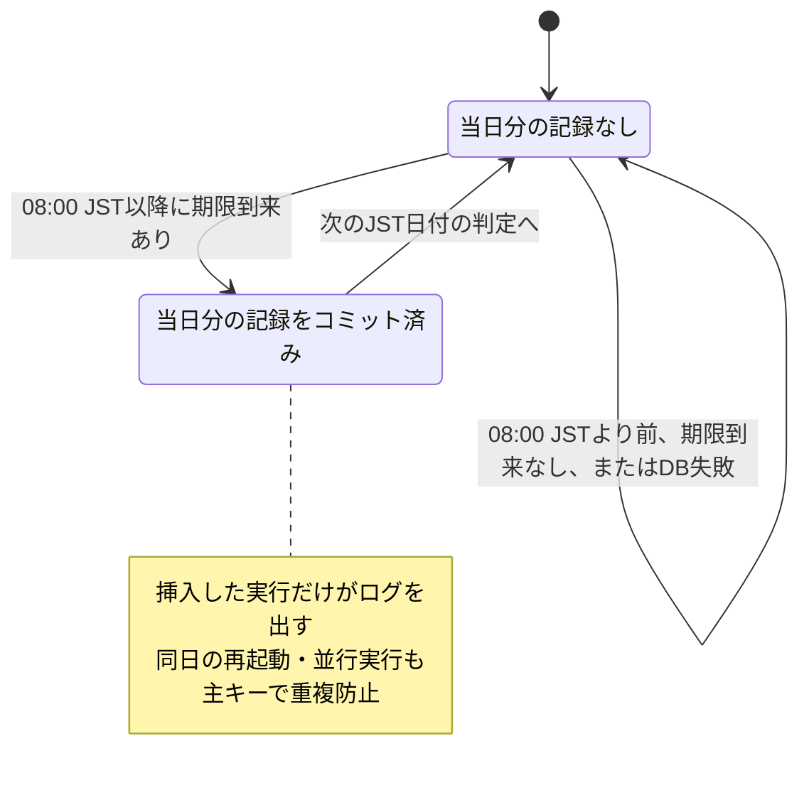

# 復習の通知ログ

契約は[仕様04](../specs/04-review.md#通知)。

## 何のためか

期限到来の復習があるユーザーごとに、件数とアプリへのリンクを1日1回ログに出す。11月27日の朝に2件の期限が来ていれば、08:00 JST以降の最初の確認で2件とアプリへのリンクを出す。ログの `user_id` は出力先のユーザーを識別する。

## 状態の流れ

## 呼び出しの流れ

1. `cmd/server/main.go:main` はサーバーの停止コンテキストを渡し、別の goroutine で `learningrecord/review_notification_schedule.go:RunReviewNotificationSchedule` を起動する。
2. `learningrecord/review_notification_schedule.go:RunReviewNotificationSchedule` → 同ファイルの `runReviewNotificationOnce`。起動直後に1回、その後は ticker で1時間ごとに実行する。失敗をログに出し、次の間隔を待つ。キャンセルでループを終える。
3. `learningrecord/review_notification_schedule.go:runReviewNotificationOnce` → `learningrecord/review_notification.go:Service.LogDueReviewNotifications`。確認時刻を Asia/Tokyo に変換し、08:00 JSTより前なら処理を終える。
4. `learningrecord/review_notification.go:Service.LogDueReviewNotifications` → 同ファイルの `Service.recordDueReviewNotifications` → PostgreSQL。期限一覧と同じ `nextReviewStage` と `reviewDueAt` で、記録ごとの次の未保存段階を計算する。期限が現在時刻以前の記録を `user_id` ごとに集計し、同日分がなければ `review_notification_days` に挿入する。
5. `learningrecord/review_notification.go:Service.LogDueReviewNotifications` がコミット済みの新規行に対してログを出す。リンクは `main` が既存の `config.CORSOrigin`（`CORS_ORIGIN`、未設定時は `http://localhost:5173`）から渡す。

## 関数ごとの表

| 関数 | 目的 | 入力 | 出力 | 更新するもの |
|---|---|---|---|---|
| `RunReviewNotificationSchedule` | サーバーの稼働中に定期実行する | 停止コンテキスト、間隔、時計、通知処理、ロガー | なし | なし |
| `runReviewNotificationOnce` | 1回分を呼び、失敗を記録する | 停止コンテキスト、スケジュール設定 | ループを続けるなら `true`、キャンセル時は `false` | 失敗ログ |
| `Service.LogDueReviewNotifications` | 朝の判定と通知ログの出力 | 確認時刻、アプリURL、ロガー | エラーまたは `nil` | 通知ログ |
| `Service.recordDueReviewNotifications` | 対象を集計して当日分を記録する | 確認時刻、JSTの日付文字列 | 挿入したユーザーIDと件数、またはエラー | `review_notification_days` |

## なぜそうしたか

- 起動時にも確認するため、昼の起動でもその日の初回通知を出せる。朝より前に起動した場合は1時間ごとに確認し、08:00 JST以降に当日分を出す。
- 日付を `YYYY-MM-DD` で渡す。たとえば2026-11-27の08:00 JSTはUTCでは2026-11-26の23:00だが、DBの `notified_on` には2026-11-27を入れる。
- `(user_id, notified_on)` を主キーにし、`ON CONFLICT DO NOTHING RETURNING` で挿入できた行だけを受け取る。ログはコミット成功後に出すため、コミット直後にプロセスが停止すると記録だけが残り、当日はログを再出力しない。

## 未決

実メール送信、希望者の同意、メール確認、配信停止、退会時削除、送信サービスの選定は後続。
