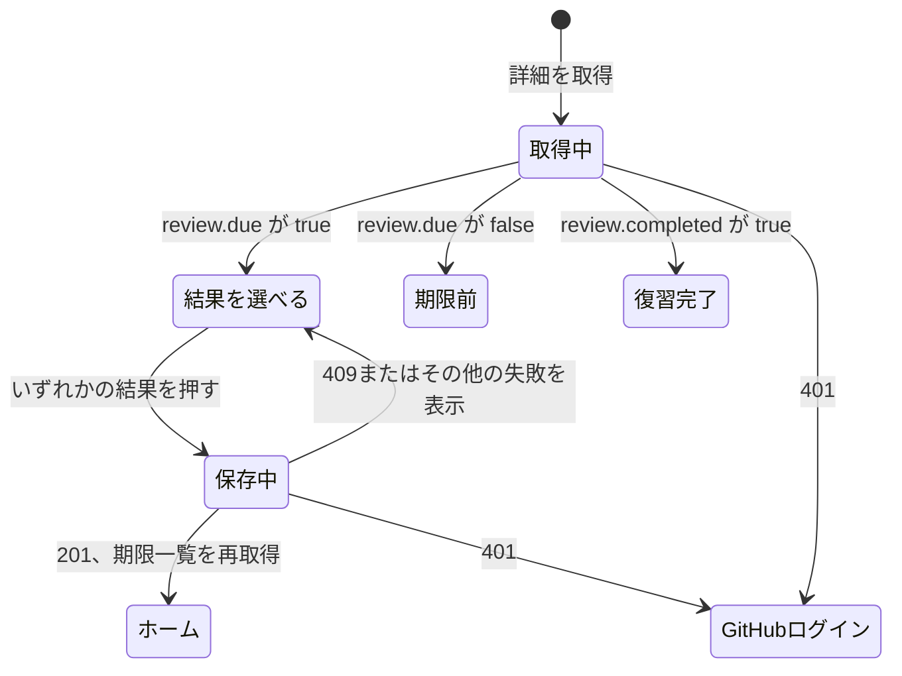

# 詳細画面で復習結果を保存する

API契約は [仕様04](../specs/04-review.md)。画面の配置は [仮の画面イメージ](../mockups/block5-pr4-detail-save.png) を参照する。

## 何のためか

学習記録の詳細で問題・回答・解説を見返し、期限が来た復習の結果を記録する。たとえば「復習 2回目」で「できた」を押すと、2回目の結果を保存してホームへ戻る。次の期限は記録の保存日時から30日後のまま。すでにその期限も来ていれば、ホームに3回目が表示される。

## 状態の流れ

詳細そのものの取得とエラー表示は [学習記録の詳細画面](learning-record-detail.md) を参照する。

## 呼び出しの流れ

1. `learning/LearningRecordDetailSection.tsx:loadRecord` → `api/learningRecords.ts:getLearningRecord`。詳細の `review` で段階・期限または完了を表示する。`due` が `true` なら結果ボタンを表示する。
2. `learning/LearningRecordDetailSection.tsx:handleSaveReview` → `api/learningRecords.ts:saveReviewResult`。Cookie付きの `POST /web/learning-records/{id}/reviews` に、選んだ `result` と表示中の `stage` を送る。
3. `internal/learningrecord/handler_review.go:saveReview` → `internal/learningrecord/review.go:Service.saveReview`。SQLは本人の記録で指定段階が未保存の最小段階に合うときに結果を挿入する。詳細は [復習結果の保存API](web-review-results.md) を参照する。
4. 201では `App.tsx:navigate` が `pushState` とパスの更新でホームを表示し、`learning/DueReviewsSection.tsx:loadDueReviews` が期限一覧を再取得する。401では `App.tsx:handleSessionExpired` を呼ぶ。

## 関数ごとの表

| 関数 | 目的 | 入力 | 出力 | 更新するもの |
|---|---|---|---|---|
| `handleSaveReview` | 選んだ結果を保存して応答を反映する | 選んだ結果、表示中の復習 | なし | ボタンの有効状態、保存エラー、表示中の画面 |
| `saveReviewResult` | 既存APIに結果と段階を送る | パスのID、結果と段階、中断シグナル | `saved`、`unauthorized`、`conflict`、またはエラー | APIを通じて復習結果を1件保存 |

## なぜそうしたか

- 復習は期限到来後に行うため、期限前は段階と期限日を表示する。全段階の結果を保存したら「復習完了」を表示する。サーバーが返す `due` を使い、端末との時計差で結果ボタンの表示がずれないようにする。
- 保存中は4つのボタンを無効にし、通信中の要求があればハンドラも送信を止める。画面を離れると通信の待機を中断する。詳細を開き直すと現在の段階を再取得する。
- 409 では詳細を開き直すよう案内する。別のタブなどで保存された後に、古い表示から次の段階を進めることを防ぐため、常に表示中の段階を送る。

## 未決

各問題の判定から記録全体の結果を決める方法は [仕様04の未決事項](../specs/04-review.md#未決)。

[変更前の動作の記録](../archive/current-work-2026-11.md#issue-88-より前の復習欄)
