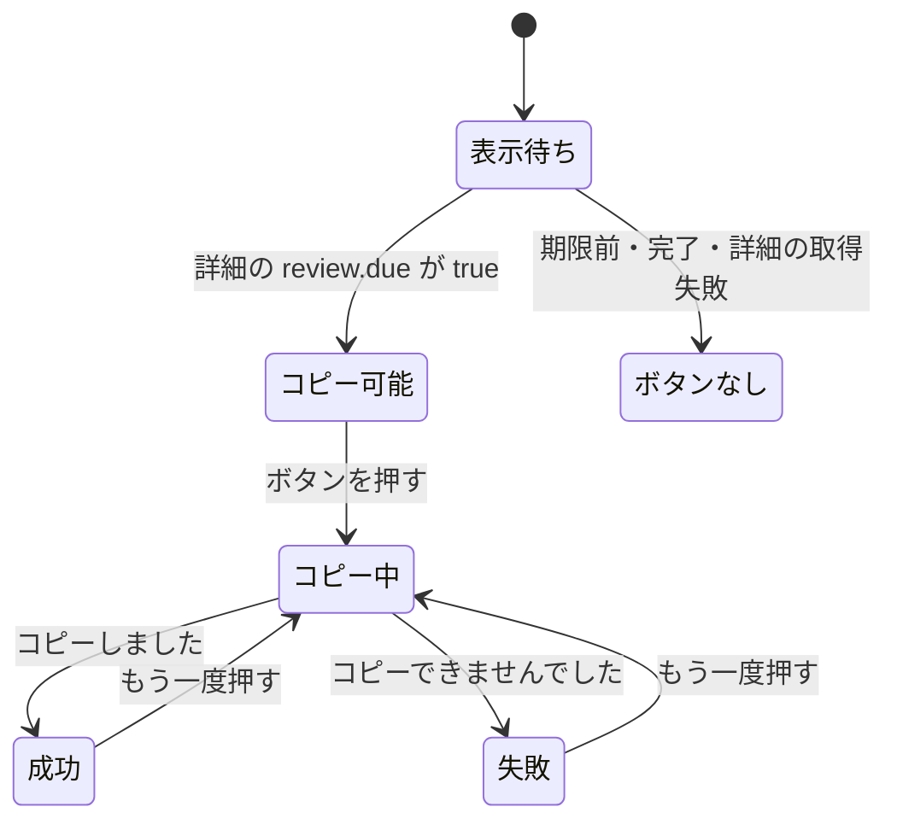

# 再開用の依頼文をコピーする

## 何のためか

「復習 2回目」などの欄で依頼文をコピーし、このアプリにMCPで接続したAIのチャットに貼り付けて、保存済みの記録から復習を進める。

コピーする文は次の1文。 `<id>` には詳細画面のパスをデコードした記録IDが入り、前後の空白や改行は付かない。

```text
get_learning_record で記録 <id> を取得し、その復習を進めてください。
```

## 状態の流れ



## 呼び出しの流れ

1. `learning/LearningRecordDetailSection.tsx:loadRecord` → `api/learningRecords.ts:getLearningRecord`。詳細の `review` を復習欄に使い、`due` が `true` ならコピーボタンを表示する。取得の詳細は [復習結果の画面](review-result-screen.md) を参照する。
2. `learning/LearningRecordDetailSection.tsx:LearningRecordDetailSection` のコピーボタン → `learning/LearningRecordDetailSection.tsx:handleCopyResumeRequest` → `navigator.clipboard.writeText`。パスの記録IDを `decodeURIComponent` して固定文に入れる。APIが無い場合や書き込みを拒否された場合は、同じエラーを表示する。
3. ユーザーが別チャットに貼り付けたあと、接続済みのAIが `id` を渡して [MCPの詳細取得ツール](mcp-get.md) を呼ぶ。コピー処理自体は通信やSQLを実行しない。

## 関数ごとの表

| 関数 | 目的 | 入力 | 出力 | 更新するもの |
|---|---|---|---|---|
| `handleCopyResumeRequest` | 固定の依頼文をコピーする | パスからデコードした記録ID | なし | クリップボード、ボタンの有効状態、成否表示 |

## なぜそうしたか

- コピーする内容を記録IDと指示に絞り、問題・回答・フィードバックは接続済みのAIがMCPで取得する。復習の段階は画面に表示する。
- 復習を始めるのは期限到来後なので、コピーできるのはサーバーが期限到来と判定した記録に限る。
- 書き込みが終わるまでボタンを一時的に無効にする。成功時は `role="status"`、失敗時は `role="alert"` で伝え、どちらの結果でも押し直せる。

## 未決

なし。[変更前の動作の記録](../archive/current-work-2026-11.md#issue-88-より前の復習欄)
