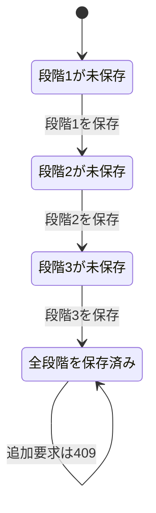

# 復習結果の保存

契約は[仕様04](../specs/04-review.md#復習結果の保存)。

## 何のためか

ログインした本人が、学習記録全体の復習結果を1段階ずつ保存する。たとえば段階1を保存済みの記録に `{"result":"一部できた","stage":2}` を送ると、段階2に結果を保存して201 `{"stage":2}` を返す。次の期限は学習記録の保存日時から720時間後。画面の案は[仮の画面イメージ](../mockups/block5-pr2-review-result.png)を参照。

## 状態の流れ

## 呼び出しの流れ

1. `cmd/server/main.go:main` → `learningrecord/handler_web.go:RegisterWebRoutes`。 `POST /web/learning-records/{id}/reviews` をセッション認証とオリジン保護の内側に登録する。
2. `learningrecord/handler_review.go:saveReview` がパスのUUID、結果、段階を検証する。結果の値が不正または未指定なら400 `invalid_result`。段階が未指定、または1〜3の整数以外なら400 `invalid_stage`。本文が不正、4 KiB超、未知のフィールドを含む場合は400 `invalid_json`。
3. `learningrecord/handler_review.go:saveReview` → `learningrecord/review.go:Service.saveReview`。SQLはIDと本人IDが一致する記録を選ぶ。指定段階が `nextReviewStage` の返す未保存の最小段階と一致したときに、結果と時計の `saved_at` を挿入する。
4. 本人の記録がなければ404 `record_not_found`。指定段階が一致しない場合、全段階が保存済みの場合、同じ段階の挿入に負けた場合は409 `review_conflict`。保存できれば201で段階を返す。DB障害は500 `internal_error`。

## 関数ごとの表

| 関数 | 目的 | 入力 | 出力 | 更新するもの |
|---|---|---|---|---|
| `saveReview`（ハンドラ） | 結果と段階を検証して保存を依頼する | 本人ID、記録ID、結果と段階のJSON | 201と段階、またはエラー | サービスを通じて結果を1件保存 |
| `Service.saveReview` | 指定した段階が次の未保存段階なら結果を1件挿入する | 本人ID、記録ID、結果、指定段階、サービスの時計 | 保存した段階、またはエラー | `learning_record_reviews` |

## なぜそうしたか

- `learning_record_reviews` の複合主キーで、同じ記録の同じ段階を1行に制限する。複合外部キーで記録と所有者を一致させ、親の学習記録を削除すると結果も消える。移行を戻すと結果テーブルと外部キー用の一意制約が消えるため、保存済み結果も失われる。
- 本人の記録を `FOR KEY SHARE` で参照し、段階の選択と挿入を1つのSQL文で実行する。同じ段階を選んだ挿入が競合すると、負けた要求はその場で409になり、後続の段階を書き込まない。
- 期限は一覧に載せる時刻で、POSTは期限前でも現在の段階を受け付ける。段階を本文で指定するため、保存確定後に同じ段階を再送すると409になる。次の段階を保存するには、その段階番号を送る。

## 未決

- 問題ごとの判定から、記録全体の結果を決める方法。
- 画面で通信断などにより応答を受け取れなかったとき、保存済みかを確かめる方法。
